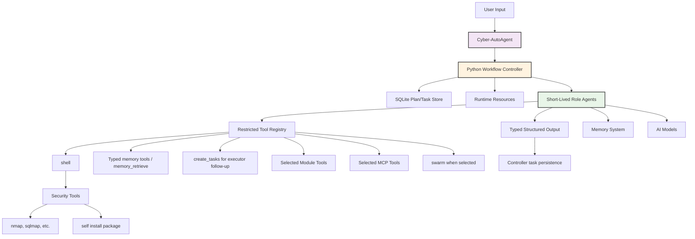
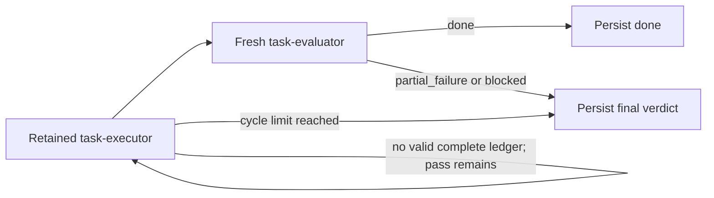
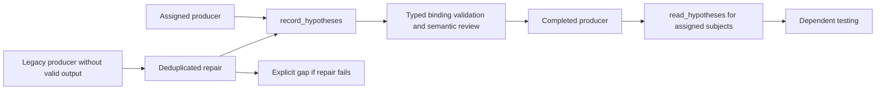
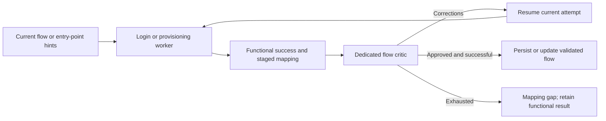
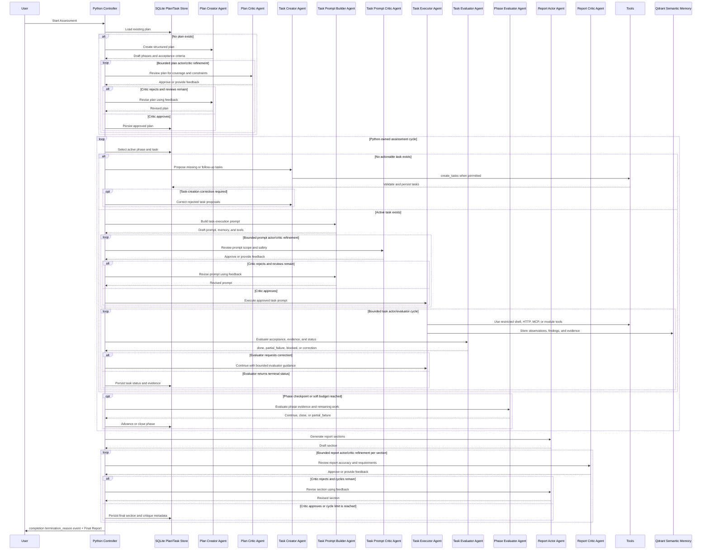
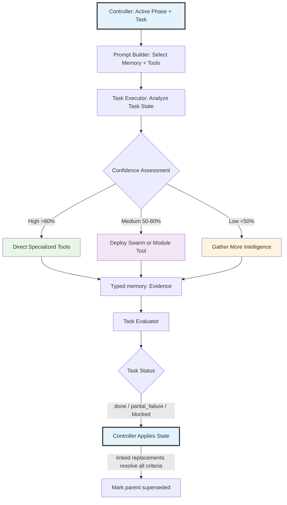
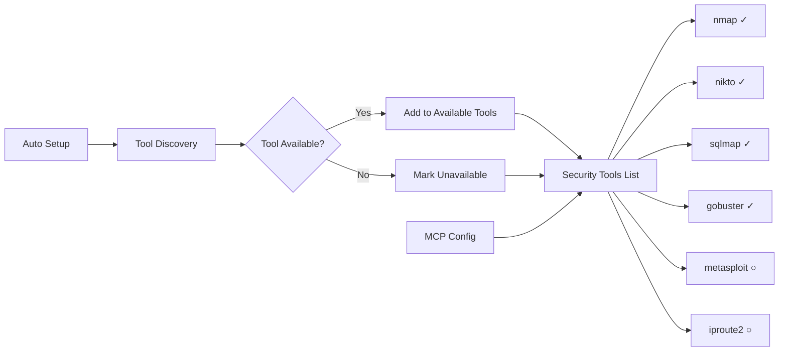
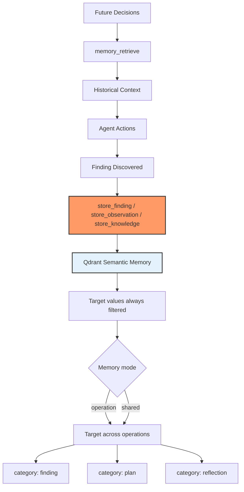

# Agent Architecture

Cyber-AutoAgent implements a **Python-orchestrated multi-agent workflow** using the Strands framework for autonomous security assessment.

## Design Philosophy: Python-Owned Workflow, Focused Agents

The core design philosophy centers on deterministic Python ownership of workflow state with short-lived agents assigned to narrow, well-defined roles.

### Why Python-Owned Orchestration?

Long-lived autonomous conversations tend to accumulate stale assumptions, lose context, and mutate plan/task state inconsistently. Cyber-AutoAgent keeps the durable operation loop in Python:

- plans, phases, and task statuses are stored in SQLite
- Python chooses the active phase and task
- Python applies task and phase evaluator decisions
- Python controls budget-aware phase progression
- agents handle reasoning, prompt tailoring, task execution, task creation, and evaluation

### Focused Agent Roles

The controller creates agents for specific jobs:

- **plan_creator**: creates or revises an initial high-level plan and infers operation-wide constraints
- **plan_critic**: reviews an initial plan and either approves it or returns actionable revision feedback
- **task_creator**: creates concrete current-phase tasks with finite acceptance contracts from a deterministic
  controller prompt
- **task_prompt_builder**: reviews core, optional-tool, and installed shell-command catalogs, then selects applicable
  memory, optional tools, and likely commands for one task
- **task_prompt_critic**: approves a proposed task execution prompt or returns actionable revision feedback
- **task_executor**: executes one active task objective and retains its conversation across critic-guided passes
- **task_evaluator**: reviews semantically complete acceptance ledgers and returns `done`, `partial_failure`, or `blocked`
- **phase_evaluator**: returns phase status: `continue`, `done`, `partial_failure`, or `blocked`

Module execution guidance supplies operation intent, explicit access boundaries, domain behavior, and evidence rules to
planning and execution roles. The module termination policy, including any advisory recommended minimum phase contract,
is also supplied directly to plan creation, plan criticism,
plan revision, and phase evaluation so required end states become measurable plan criteria. A controller-owned executor
contract keeps individual workers scoped to one task regardless of module.

Each task also has an immutable acceptance manifest. Procedure bases declare machine-readable limits and whether they
produce a generic artifact or versioned inventory manifest; coverage bases freeze one inventory artifact and its hash.
Executors submit an atomic evidence-backed result for every criterion and, for coverage work, one terminal disposition
per manifest item. Python resolves typed artifact, memory, observation, and finding evidence before semantic
evaluation. This preserves broad, cohesive work under one retained executor without allowing moving completion
targets.

### Replacement and Supersession

When a task cannot complete and its remaining intent must be split or retried as new work, replacement tasks declare
`replacement_of` with the parent task UID and identify the parent criteria they resolve in `supersedes_criteria`.
Python reconciles this lineage before phase closure. The parent becomes `superseded` only after every parent criterion is
covered and every linked replacement is `done` or `superseded`. The parent record, evidence, and failure reason remain
available for audit. Unlinked failures remain blocking, and Python does not infer replacement relationships from
similar wording.


The swarm tool remains available as an execution capability, but it is no longer the top-level orchestration model.

## Core Architecture



## Strands Tools

Agents operate through role-specific restricted tool lists.

### Primary Tools
- **shell**: Execute system commands (nmap, sqlmap, custom scripts)
- **editor**: Create/modify files and custom tools
- **swarm**: Deploy parallel agents for complex tasks
- **http_request**: Make HTTP requests for web testing
- **memory_list / memory_retrieve**: List or semantically retrieve findings and knowledge
- **load_tool**: Dynamically load created tools
- **create_tasks**: Create durable follow-up tasks from task executors when permitted

Plan/task state transitions are owned by Python workflow code. Task creators return schema-validated `TaskProposal`
payloads, which Python validates and persists without an agent tool call. Task executors may still add contracted
follow-up work with `create_tasks` when permitted. Active task context is injected into the role prompt by the workflow;
agents do not fetch it with a tool.

Planning, prompt-building, evaluation, taxonomy, reporting, and evaluation-policy roles use provider-backed structured
output schemas. Strands lets LiteLLM and Bedrock select native response schemas or their internal tool fallback. When
any provider/model cannot complete that protocol, the controller records an operation-local capability downgrade and
uses bounded, schema-validated JSON repair for later structured roles in the same operation. Schema validation and
ordinary provider failures retain their normal bounded-retry behavior rather than triggering this compatibility path.

There is no agent-callable stop tool. When Python workflow evaluation determines the assessment is complete, the controller emits a `termination_reason` event with reason `complete`.

Generated plan constraints are durable workflow guardrails. Task creation and prompt-building roles must honor them,
and task/phase evaluators prevent successful completion when evidence shows a constraint violation.

Initial plan generation uses a bounded actor/critic cycle before persistence. Critic approval immediately accepts the
current draft; rejection sends feedback to `plan_creator` for revision. The
`CYBER_WORKFLOW_PLAN_REFINEMENT_ITERATIONS` environment variable limits reviews and defaults to seven. A rejection on
the final configured review fails the workflow so an unapproved plan is never persisted or executed.

Task prompt generation uses the same bounded pattern. `CYBER_WORKFLOW_TASK_PROMPT_REFINEMENT_ITERATIONS` defaults to
three critic reviews and accepts `0` to disable critique. After JSON retries, malformed or unavailable builder/critic
output and non-scope prompt defects that survive one bounded repair use a deterministic controller task template.
The template has no model-selected optional tools or shell commands, and selects only canonical memory references.
The controller emits `task_prompt_fallback` for that recovery. Only a valid critic response explicitly identifying a
hard target-scope violation marks the active task `partial_failure` without invoking its executor or evaluator.

Login and provisioning workers discover flows while completing their assigned action. Dedicated flow critics
review staged metadata and current-task evidence; only successful, approved flows are persisted. The worker keeps
its browser progress and identity across corrections. Successful login or registration remains usable if metadata
review cannot approve a reusable mapping. Authentication recovery permits one additional functional worker
pass before recording a gap.
Browser capture tries up to eight distinct observed credential-bearing GET requests and requires an
anonymous/authenticated difference. Repeated failed capture inputs require new browser evidence or corrected
metadata. Successful capture saves a secret-free proof artifact; controller validation supersedes earlier
recorder output in flow reviews. Session freshness remains checked before reuse and requests.
Initial metadata recording precedes up to three critic reviews,
with repairs between rejected reviews. After functional success, repairs use only observation and recording
tools. Review events and persisted gaps include the review count and stopping reason; a completed identity
or session does not imply an approved reusable flow. See [credential workers](#credential-workers) for the execution sequence.

| Variable | Default | Description |
|----------|---------|-------------|
| `CYBER_WORKFLOW_FLOW_REFINEMENT_CYCLES` | `3` | Maximum flow-critic reviews per attempt; minimum one. Initial recording does not consume a review. JSON retries are separate. |
| `CYBER_WORKFLOW_FLOW_REFINEMENT_SEARCH_LIMIT` | `16` | Searches per worker invocation or per distinct authorized artifact for critics; minimum one. |

Artifact errors explain the exhausted read or search allowance. Critics synthesize from returned evidence when
access is exhausted; JSON repair and one transient retry keep artifact access closed. Approval still requires
current-task evidence selected by the critic. These retries do not consume semantic correction cycles.

Task execution then uses a second bounded actor/critic loop:



`CYBER_WORKFLOW_TASK_EXECUTION_CYCLES` limits executor attempts to produce a valid atomic ledger, defaults to three,
and has a minimum of one.
while `CYBER_TASK_ACCEPTANCE_MAX_CORRECTIONS` independently limits rejected acceptance repairs to two after the initial
submission. Repairs retain the executor conversation and stop early when an equivalent rejected payload is repeated.
Once that ledger exists, the evaluator's semantic verdict is terminal because the ledger cannot
be revised. Python persists `done`, `partial_failure`, or `blocked` without replaying completed acceptance.

Task creators return one typed proposal batch, after which Python applies the existing preflight, deduplication, and
durable persistence checks. Rejected batches remain correctable within the configured bound. Task executors stop after
a complete `record_task_acceptance` result; rejected calls remain correctable.

The task prompt builder uses the frozen task and acceptance contract to describe only the assigned execution steps.
Python appends the full acceptance contract and operation constraints to the approved executor prompt. Authentication
setup runs between prompt approval and task execution; an assigned unauthenticated baseline remains executor work.
Cookie and Authorization header restrictions follow their stated operation and target scope. The prompt critic reviews
the draft against this assembled context and does not require it to repeat controller-owned rules. The builder and
critic see the controller-supplied task tools, including authenticated-context refresh when authorized; the critic's
tool catalog uses the same resolver as execution. Controller-supplied tools are not optional-tool selections.
Automatic task prompt memories are limited by controller-owned task, target, and frozen inventory-item provenance;
unscoped observations and findings remain available through explicit retrieval rather than appearing in every task
prompt. General unscoped knowledge can still guide task planning. Prompt memory catalogs show provenance alongside
each selected item. Before authentication setup, prompt builders cannot supply credential IDs. After setup, executors
may use controller-validated opaque IDs in authorized tool calls and durable evidence when acceptance requires ID
binding, while keeping secret credential values out of reportable material. For self-registration, the recorder's
legacy `login_url` argument carries the mapped registration URL; a success redirect is recorded only if observed.

Every role invocation also has deterministic safety bounds. Three consecutive responses without a new tool action stop
a required-tool role as stalled, regardless of tool calls or reasoning emitted during an earlier actor cycle. An
absolute controller-to-agent call ceiling bounds repeated invocations, while the Strands SDK `turns` limit bounds model
calls and tool executions inside each invocation. Task-executor actor cycles allow 8 agent calls with 32 SDK turns per
call, bounded tool-recovery runs allow 4 calls with 8 turns, and task creators allow 3 calls with 6 turns.
No-action redirection prompts respect the role policy: roles that disallow text completion are instructed to call an
outstanding required tool and are never offered a text-only final-answer path. Task executors instead receive a
task-progress redirect because their required acceptance tool is a completion condition: they call the next tool needed
for unmet criteria and durable evidence, then submit acceptance after its prerequisites are complete.

Bounded procedure contracts declare whether their output is a generic artifact or a version-1 inventory manifest.
Python rejects mismatched evidence requirements during task creation. Inventory executors receive the canonical JSON
shape in both their task prompt and acceptance-tool description, and acceptance validation evaluates each referenced
artifact independently so an unrelated supporting file cannot invalidate a separate valid inventory.

Each retained task executor also keeps a bounded controller-owned tool-outcome journal. A locally correctable failure
permits prerequisite inspection or creation, independent work, alternative methods, and two changed retries by
default. Structured memory and acceptance validation errors enter the same correction path. Identical failed calls are
blocked locally, and equivalent failures are counted across retained executor cycles so conversation boundaries cannot
restart an unbounded loop. Recovery does not lock unrelated tools or durable evidence operations.
Generic executable startup and dependency failures quarantine only that executable for the current operation; later
task prompts omit it while capability-compatible commands remain available. An unresolved correction is
deterministically `partial_failure`. Evaluators receive the authoritative outcome journal separately from the worker's
final narrative and must prefer it when the two conflict. Failed diagnostic and preflight shell commands remain visible
in the journal but do not start recovery.

Shell-tool discovery first resolves each configured command on `PATH`. A tool may optionally declare a side-effect-free
`canary` object with `args`, `timeout_seconds`, and `accepted_exit_codes`; successful canaries mark tools verified.
Commands without a safe standalone canary remain available but unverified. The Docker tools-image verifier implements
the same configuration contract independently and is not imported by application runtime code.

Task creation similarly has a deterministic structured-output boundary. After an initial rejected proposal, the
controller may request up to `CYBER_TASK_CREATOR_MAX_CORRECTIONS` corrected payloads (six by default). The initial
prompt contains stable phase context and corrections contain only the prior validation error. Agents submit a flat
`TaskProposal` whose `limits` object is always required. Python discards it and `output_kind` for snapshot work,
infers the basis, supplies procedure invariants, derives source references and target scope, and compiles the proposal
before storage. Inventory-wide moving collections are rejected as procedures and must use frozen snapshot references.
Exact frozen-contract duplicates are skipped deterministically within the active phase; completed coverage from one
phase does not suppress work against the same snapshot in a later phase. Unfinished coverage retries remain eligible,
and duplicate-only payloads remain eligible for a bounded corrected submission.

Successful task acceptance populates task evidence with the validated immutable ledger references. Phase
evaluators receive that canonical per-criterion ledger and may read only its resolved artifact paths, preventing stale
predicted filenames from overriding accepted evidence. Task creators use a closed flat schema with explicit limits,
criterion descriptions, snapshot references, and target IDs. Python generates readable unique criterion IDs and
evidence requirements and owns the remaining contract and lifecycle fields.

Before an acceptance ledger is persisted, controller validation copies artifact evidence into a task-owned immutable
path within the operation root. Independent inventory-producing tasks therefore cannot overwrite one another's
accepted outputs. When a following phase consumes multiple completed inventory manifests, Python creates one merged,
provenance-preserving snapshot for fan-out. A manifest is not valid proof for a task frozen to a single inventory
subject; that rejection occurs before ledger persistence. Prompt-memory selectors are advisory: stale IDs or indices
are logged and dropped while valid selected context remains available to the executor.

A testing phase that depends on hypotheses creates tasks only for inventory groups with completed, validated
hypothesis deliverables. `record_hypotheses` publishes a `hypothesis_set_v1` artifact and a controller-owned digest
binding. Python supplies the operation, producer, frozen snapshot, subject assignment, and hypothesis IDs. Every
assigned subject must have testable hypotheses or a reasoned `no_testable_hypotheses` disposition. The contract is
protocol-neutral: HTTP endpoints, network services, and source/filesystem subjects use the same reasoning fields.
Current-operation supporting artifacts establish availability; the actor/critic review still evaluates their support.
Research references remain advisory. Inventories, memory summaries, and completion prose do not satisfy the typed
`hypothesis_set` acceptance requirement.

Consumers receive only bound hypothesis output references, producer IDs, digests, and a compact subject index;
supporting inventory inputs remain separate. `read_hypotheses` validates the binding and frozen assignment on every
bounded subject read. Older producers without valid output get one deduplicated repair task per original producer
and frozen contract. The original completed task and its acceptance ledger remain unchanged. Testing waits for
validated repair output or records an explicit prerequisite coverage gap.

The same fields describe each module's native actions; subject identity comes from the frozen inventory:

| Subject | Attacker-controlled input/action | Safe test and control |
|---------|----------------------------------|-----------------------|
| HTTP endpoint | Query parameter | Compare a harmless probe response with an unchanged parameter control. |
| Network service | Protocol frame field | Compare two bounded protocol exchanges and save both responses. |
| Source/filesystem component | Data read from a configuration file | Trace the input to its consumer and compare isolated fixtures. |


The hypothesis phase persists its verified source inventory manifest in plan metadata before its execution cap check.
On older plans, the controller reconstructs that binding from valid task assignments or a completed inventory
producer. This lets the dependent phase measure missing coverage even when the hypothesis phase has no task records.
If a hypothesis phase reaches its cap before covering every group, the controller records the uncovered groups,
continues testing covered groups, and reports the remaining coverage as an incomplete assessment. With no completed
hypotheses, the dependent phase closes as a partial failure without creating generic testing tasks. If no verified
source manifest is available, it records a prerequisite gap and also closes as a partial failure.

### Authentication design goals and decisions

This section records the rationale for credential workers and flow review. Future changes should preserve
these goals and use the credential-worker tests as regression checks.

- **Discover through execution.** Provisioning and login workers learn the complete flow while performing
  their assigned action, including multi-step forms. An existing flow is a starting point that can be corrected.
  Separate discovery agents cannot reliably establish that an account was created or a session works.
- **Separate completion, freshness, and mapping approval.** Successful account creation or login is a durable
  fact; session freshness determines whether requests may run; critic approval determines whether a reusable
  mapping may be published. Metadata rejection or expiry during review must not repeat a successful action.
  Historical login completion must never substitute for a fresh session.
- **Keep proof and provenance in Python.** The controller binds task scope and credentials, correlates outcomes,
  saves validation proof, and checks critic references. HTTP success and readable artifacts establish availability,
  not authentication. Reusable HTTP contexts require a credential-dependent difference from anonymous access.
  Visible signed-in SPA controls alone do not prove that replaying their public HTML route authenticates requests.
  Login workers attempt context capture after successful browser navigation and actions. Incomplete capture
  allows multi-step interaction to continue; successful validation stops further authentication actions.
  Navigation saves the rendered DOM, and reviews retain cumulative current-task evidence across worker sessions.
- **Persist instructions independently of artifacts.** SQLite flow descriptors survive across operations.
  Loading a validated flow does not require its original files. Historical references and approval digests
  are excluded from replay instructions and cannot authorize current proof; Qdrant memories remain advisory.
  Reuse requires live execution with current-operation evidence. Approved repairs update the existing flow;
  unsuccessful repairs preserve the previously validated descriptor.
- **Support application-defined credentials.** Cookies, arbitrary named headers, and configured storage bindings
  may be used together; token formats are not restricted to JWT. User-provided API keys and header values use
  direct validation, with no login or self-registration requirement.
- **Preserve credential isolation.** Each worker uses one selected credential or generated registration identity
  throughout retries. Completion and proof from one account cannot establish another account's session.
  Tasks use one account unless their declared comparison requires two independent accounts and sessions.
- **Review the applicable contract.** Critics review the bound recorder's editable fields and observed evidence.
  Controller validation supersedes earlier recorder output and cannot be repaired by an actor. Browser labels
  may contain Unicode or emojis; backend payload names are not mandatory. Unknown transport details remain
  empty, and requiredness needs rendered constraints or observed validation.
  `request_header_names` describes credential transport on authenticated requests, including headers first used
  after login. It is not limited to login-submission headers. Controller-proven header names are authoritative.
- **Bound recovery without weakening proof.** Context capture tries at most eight distinct observed requests.
  Identical failed capture inputs require new relevant browser evidence or corrected metadata before replay.
  Authentication gets one functional recovery pass; completed flows get three critic reviews by default.
  After success, actors receive only observation and recording tools, preventing repeated login or registration.
- **Keep model guidance concise.** Tool errors explain missing evidence, failed replay, and indistinguishable
  responses. Python performs deterministic selection and bookkeeping; agents reason about observed application
  behavior. Avoid target-specific paths, fixed header assumptions, and expanding prompts with incident details.

### Credential workers

Authentication and provisioning workers discover flows during authorized interaction. There is no separate
observation-only discovery prerequisite. A current-version completed flow is supplied as a starting point;
otherwise, the worker uses target-scoped entry-point hints. Workers may correct the mapping and follow observed
connected steps within assigned origins, while retaining the selected credential or registration identity.

Worker-bound recorders stage secret-free descriptors, including ordered `steps` with observed routes, action kinds,
and field names. Python binds the task and operation and checks active task scope on recording. Browser context
capture uses staged header metadata instead of requiring a persisted flow ID. Credential access still requires
one active task, and credentials and session values are never included in reusable descriptors.

Dedicated `authentication_flow_critic` and `registration_flow_critic` agents review current-task observations and
select `supporting_evidence_refs`. Python validates their selection and computes approval digests. Authentication
publication requires completed opaque-context validation, even if that context expires during metadata review;
registration publication requires a successful credential-storage call whose durable metadata confirms a
registered credential for the assigned target and role. Only approved,
successful flows are stored as validated records. Corrections update an applicable existing record instead of
creating duplicate unreviewed descriptors. Authentication version 10 and registration version 4 are accepted;
older versions and discovery settings have no compatibility path.

After functional completion, the flow critic performs up to three reviews, with metadata repairs between
rejections. Initial recording does not consume a review. Authentication permits one functional recovery pass
after an unsuccessful initial worker; failed recovery records a gap without invoking a flow critic.
Corrections continue from the browser and retained outcomes. Every functional repair retains its worker run policy. Invocation-local tool hooks check controller-owned
completion after each result and cancel remaining queued calls before execution. Login ends at a validated
context or definitive credential rejection; provisioning ends when the task-bound registered credential is
durably stored. Metadata repairs end at flow staging, returning control to the critic. Terminal reasons survive
the executor result boundary and appear in worker completion logs.
After functional success, the controller supplies only observation, artifact, and flow-recording tools for repairs,
preventing another login or account creation. A definitive credential rejection stops the attempt. Exhausted flow
review retains functional credentials and contexts and records a mapping gap; provisioning task evaluation remains
separate. Unknown transport details may remain empty for browser mappings, while multi-step mappings retain their
observed sequence.
Task proposals declare `authentication_requirement` separately from established `auth_context`:
`{"comparison": "none", "roles": ["member"]}` requests one account per assigned target and required role.
The default is `none` with no role filter, which selects one eligible account per assigned target.
An unauthenticated baseline adds no credential requirement. Explicit `account`, `role`, or `tenant` comparisons
select a qualifying pair from recorded identity metadata; distinct credential IDs alone do not prove distinct accounts.
Web and web-recon module contracts declare `authentication_matrix_workstreams`. Python expands each scoped
template using target-scoped roles from credential metadata (including unavailable credentials) and structured
registration flows. Role applicability is independent of credential and session availability.

| Comparison | Expansion | Credential requirement |
| --- | --- | --- |
| Unauthenticated versus role | Once per defined role | One account for that role |
| Same role, different accounts | Once per defined role | Two distinct accounts sharing the role |
| Different roles | Once per unordered pair of defined roles | One account from each role |

An application with one defined role has no different-role tasks and no coverage gap for their absence.
Missing credentials for an applicable comparison remain an execution gap. Controller-owned HTTP comparisons
retain anonymous and authenticated responses, reusing matching current-operation baseline evidence when possible;
response differences alone do not establish a vulnerability. Non-HTTP modules can opt into the same declarative
matrix without browser or HTTP assumptions. Explicit tenant comparisons retain their existing selection contract.
On continuation, unfinished inherited templates and contradictory role-selection failures are superseded by
applicable comparison tasks. Frozen inventory subjects are preserved; completed work and frozen validation
credential bindings are retained. Reconciliation is idempotent. Identity availability is checked before executor
prompt construction, and error events retain the requested comparison and roles.
Python persists requirements during task fan-out, prefers valid sessions, and authenticates only selected identities.
Session reuse and authenticated requests enforce a 600-second safety window for known JWT and cookie expiry.
Material with less than 600 seconds remaining requires refresh; unknown expiry still requires behavioral validation.
One alternate selection is allowed after failed setup; frozen finding-replay credentials are never substituted.
The two-account provisioning pool remains available without logging both accounts in for every task.

The controller stores secret-free completion facts in SQLite-backed task recovery context: credential identity,
task and operation provenance, supporting artifacts, and separate functional and mapping states. Registration
acceptance is recorded directly from a successful task-local storage result and the matching persisted credential.
A module-specific reconciliation callback corrects contradictory acceptance submissions before publication to
memory. Fresh continuations and evaluators receive these facts without rereading registration artifacts. Restored
facts are checked against current credential or authenticated-context state. A successful login proves only its
credential setup, not unrelated criteria of its parent task; mapping failures remain separate from functional success.
Classified inventory authentication routes and validated registration redirects are scoped navigation hints,
without inferred flow kinds or authentication proof. Current controller header mappings take precedence over
stored mappings and are shared by prompts, flow staging, and context capture. Provisioning storage binds target,
role, and registered origin in Python. Registration step field names describe observed controls; required and
optional classifications need supporting evidence, with unknown classifications omitted.
Every agent event handler has a passive outcome recorder sharing its journal. SDK priority captures original
results before recovery callbacks rewrite them. Worker sessions expose task-local outcome snapshots, and the
controller retains those outcomes across review corrections.




Task prompt builders and critics receive a compact plan projection, applicable phase metadata, the assigned contract,
and status counts with at most five related task summaries. Their initial requests and retries are measured using
model-aware token estimates, including system instructions, tool/output schemas, and the current output allowance.
Python aims for 80% of input capacity by reducing advisory history, memory candidates, and catalog descriptions in
that order. Runtime tool names remain available, selected memory context and selected input schemas remain intact,
and required scope and acceptance content are never truncated. An irreducible overflow produces a diagnostic before
inference and uses the existing deterministic fallback where eligible.

Authentication analysis keeps route classifications in `candidate_mechanisms` and response-backed structural
indicators in `observed_indicators`. The legacy `summary.mechanisms` field includes only supported protocol
indicators: structured OIDC/JWKS documents, SAML metadata/messages, JWT structure, or OAuth authorization redirects.
Observed indicators link to saved response artifacts. Cached protocol observations are reused only when those
responses are readable within the current operation and their body digests and response metadata still match.
Cookies and password forms remain observed indicators without establishing a protocol or validated flow.
Protocol step descriptions are hypothetical; executable flow approval and login validation remain separate.

Identical inputs reuse both successful approvals and terminal failures across continuations. Changed inputs create a
new prerequisite linked to its predecessor; an explicit failed-task reset makes the existing prerequisite eligible
to run again. Superseded failures remain archived for audit, and successful retries clear the consumer's current gap.
Missing or changed approval artifacts and ineligible flow lifecycle status invalidate reuse. Budget
interruptions leave the prerequisite unfinished rather than caching a failure. Discovery keeps its existing actor/critic
cycles (three by default), transient retry, JSON repair, and bounded artifact-access recovery.

Web authentication coverage and web-recon access-context fan-out omit static asset routes only after a bounded,
credential-free same-service GET confirms a 2xx response with a static media type. The controller records excluded
inventory IDs and response metadata in an operation artifact; uncertain responses stay eligible, and the assets remain
in the frozen inventory for later phases.

Execution requirements remain frozen in the task contract, but execution proof is controller-owned. The controller
matches successful task-local tool capabilities and normalized subjects to durable current-operation artifacts when
the executor submits acceptance. If proof is missing, Python retains the semantic acceptance payload, permits one
bounded repair against the exact missing requirement, and replays acceptance without another model bookkeeping call.
Merged phase inventories use content-addressed immutable paths and union complementary protocol-neutral interaction
metadata so later task creation cannot mutate an earlier frozen snapshot or discard methods and inputs.

Complete task acceptance also publishes one bounded operation observation containing the task objective, criterion
statuses, concrete summaries, evidence references, and aggregate coverage counts. Publication is replay-safe and lets
later task-prompt-builders select accepted information by memory ID. A memory-backend failure is reported in the tool
result but does not invalidate the immutable acceptance ledger or add an undeclared evaluator requirement.

There is also no prompt optimizer tool, prompt rebuild hook, or stalled-loop conversation rebuild fallback. Prompt
adaptation is workflow-native: prompt-builder agents receive current plan state, active phase/task context, compact task
history, memory summaries, and selected optional tool candidates. Python enforces proportional phase budget caps before
task work and handles separate advisory checkpoints before pending task activation.

### Security Tool Access

Security utilities are normally reached through the restricted shell capability. The active role receives only the
capabilities allowed for its task, and command output is captured as operation evidence.

### MCP Tool Access

MCP tools can be accessed as direct tools, but they are optional tools. They are selected per worker role and task objective, not included in every worker's core tool list. The controller can also add built-in optional tools from structured task-contract output and evidence requirements. For an inventory-manifest task, this includes the converter and the available direct recon/auth producers. This deterministic selection supplements the prompt-builder's choices and never derives tool access from task prose.

## Execution Flow



The actor/critic loops are bounded by separate configuration values: plan refinement, task-prompt refinement, task
execution cycles plus evaluator corrections, and report refinement cycles. The controller remains the source of truth for
state transitions; agents propose plans, prompts, evidence, evaluations, or revisions but cannot directly activate or
close phases and tasks.

## Role-Agent Reasoning

Focused agents still use the Cyber-AutoAgent methodology, module guidance, confidence updates, and evidence standards. The difference is that role prompts constrain the scope of each agent.



**Key Principles:**
- **Python State Authority**: Controller owns phase/task transitions and plan completion
- **Focused Reasoning**: Agents receive narrow role prompts and task-specific context
- **Metacognitive Awareness**: Agents assess confidence within their assigned objective
- **Dynamic Capability Expansion**: Workers can use shell, selected tools, and swarm when appropriate
- **Centralized Memory**: Discoveries flow into Qdrant and reports query operation-scoped evidence

## Tool Hierarchy

Based on confidence, task complexity, and role-specific tool selection:

1. **Specialized Security Tools** (via shell)
   - When vulnerability type is known
   - High confidence scenarios
   - Direct exploitation

2. **Swarm Deployment**  
   - Multiple approaches needed
   - Medium confidence
   - Parallel reconnaissance

3. **Meta-Tool Creation** (via editor + load_tool)
   - Novel exploits required
   - No existing tool fits
   - Custom payload generation

## Environment Discovery



Tools discovered via `which` command:
- Available tools accessible via `shell`
- Unavailable tools noted but not usable
- Dynamic discovery adapts to environment

MCP Tools pre-configured:
- Python reads from `CYBER_MCP_CONNECTIONS` environment
- React reads from `config.json`
- MCP Server is assigned or one or more modules

## Memory Integration



**Memory Storage**:
1. **Plans, Tasks, and Model Metrics**: Stored in `outputs/cyber_autoagent.db`, scoped by exact logical target and
   operation ID. Model metrics are append-only per provider/model capture and include their capture timestamps.
2. **Semantic Memories**: Stored in one Qdrant collection under `outputs/qdrant`, or in the configured Qdrant service.
3. **Scope**: Exact target values are always criteria; operation ID is additionally required in `operation` mode.

**Evidence Storage Format**:
```
[VULNERABILITY] SQL Injection
[WHERE] /login.php?id=1
[IMPACT] Database access, credential extraction
[EVIDENCE] Request/response pairs, command outputs
[STEPS] Reproduction steps
[REMEDIATION] Use parameterized queries
[CONFIDENCE] 95% - Verified
```

## Model Providers

### Bedrock Provider (AWS)
- **Primary**: Claude Sonnet 4.5 (claude-sonnet-4-5-20250929-v1:0)
- **Embeddings**: Titan Text v2 (amazon.titan-embed-text-v2:0)
- **Region**: us-east-1 (default, configurable)
- **Benefits**: Latest models, managed infrastructure, reliable performance

### Ollama Provider (Local)
- **Primary**: qwen3.6:27b (default)
- **Embeddings**: mxbai-embed-large:latest
- **Benefits**: Privacy, offline, no API costs, local control

### LiteLLM Provider (Universal)
- **Primary**: 100+ models supported (OpenAI, Anthropic, Cohere, etc.)
- **Configuration**: Provider-specific API keys
- **Benefits**: Multi-provider flexibility, unified interface

## Event System and UI Integration

**AgentEventHandler** extends the Strands SDK's callback system to emit structured events for UI consumers:

### Event types emitted during operation

- tool_start: Tool invocation with parameters
- tool_end: Tool completion with results
- reasoning: Agent decision-making context
- metrics_update: Token usage, cost, duration, and budget progress
- progress_update: progress updates
- operation_init: Operation metadata and configuration

Events flow from the Python agent through stdout using the `__CYBER_EVENT__` protocol, enabling real-time monitoring without tight coupling between backend and frontend.

## Evaluation System

**Automated Performance Assessment** using Ragas metrics integrated with Langfuse:

| Metric                   | Range   | Purpose                                   |
|--------------------------|---------|-------------------------------------------|
| tool_selection_accuracy  | 0.0-1.0 | Strategic tool choice and sequencing      |
| evidence_quality         | 0.0-1.0 | Comprehensive vulnerability documentation |
| methodology_adherence    | 0.0-1.0 | Defensible methodology alignment          |
| penetration_test_quality | 0.0-1.0 | Holistic assessment quality               |

Evaluation triggers automatically after operation completion when `ENABLE_AUTO_EVALUATION=true`, providing continuous feedback for system improvement.

## Key Design Principles

1. **Python-Owned Orchestration**: Durable workflow state is managed by code, not by prompt instructions.
2. **Focused Role Agents**: Each agent receives a short, defined objective and restricted tools.
3. **Soft Budget Distribution**: Phase progress is evaluated against proportional budget targets.
4. **Evidence-Focused Memory**: Findings, observations, and proof references are stored in Qdrant for retrieval and reporting.
5. **Swarm Intelligence as a Capability**: Workers may deploy specialized sub-agents when useful, without giving up controller state authority.
6. **Tool Agnostic Execution**: Shell can access installed tools, while optional MCP/module tools are selected per task.
7. **Continuous Evaluation**: Automated performance metrics support operational improvement.

This architecture enables autonomous operation while keeping workflow control deterministic, inspectable, and resilient to context loss.

# Controller-owned authenticated coverage

For web phase-3 tasks, the controller can execute an authenticated credential-coverage task when its frozen inventory
provides an in-scope HTTP endpoint with a recorded GET or HEAD interaction. The authentication worker establishes or
refreshes an opaque context only when needed. The controller then uses each validated, task-authorized credential ID
to request the endpoint without following redirects and stores the response with a specific gap for failed requests.
Authorization comparisons and interactions without a safe recorded method continue through task executors.

Authenticated task executors can call `refresh_authenticated_context` for a credential already bound to their task.
When only one credential is authorized, credential tools take no credential ID; tasks with multiple authorized
credentials still select an ID. The controller runs the authentication worker for that credential and returns only
`ready` or `unavailable`.
The executor can retry a failed authenticated request once after `ready`; credential material stays with the worker.
For example, if a token expires during a long task, the executor requests a refresh before retrying its GET.
Each refresh outcome is recorded as a secret-safe operation event with the task and opaque credential IDs.

Each credential worker receives one selected credential and flow. Its checkout and context tools bind those fixed
identifiers, while browser capture still requires the URL observed in authenticated HAR traffic. The worker prompt
contains the existing login route, required header names, and assigned navigation hints. It discovers missing
steps during login and updates the mapping after functional success and dedicated critic approval.

The controller requires at least 10 minutes of known authentication-material lifetime when assigning a context to a
new task. HTTP validation still probes the protected route when less time remains. An active task may use a context
that passes that probe until the material expires; known-expired material cannot be used for an endpoint request.


### Browser authentication verification and partial network evidence

Reusable browser login instructions omit historical verification steps. After a successful login,
the controller sets the flow's validation URL and verification step from the current credential's
validated execution before critic review and persistence. Navigation, form submission, and redirect
steps remain available for multi-step login. Registration and API credential validation keep their
existing behavior; prior execution evidence remains historical context.

Browser network HAR responses include `_body_capture_status` (`available`, `unavailable`, or
`timeout`), also shown in previews. Missing response bodies preserve request metadata, status,
headers, redirects, and HAR indices. An empty available body has size zero; an unavailable body has
unknown size. Metadata availability does not establish authentication or vulnerability conclusions.
