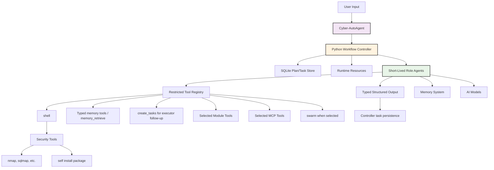
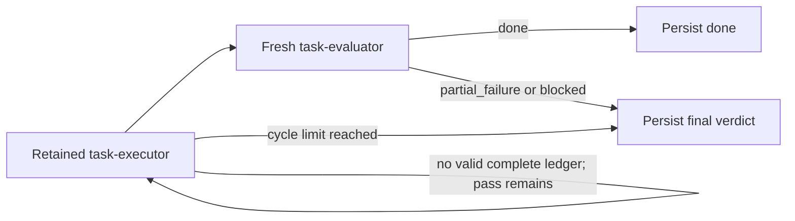
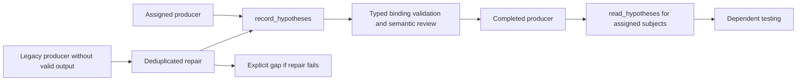
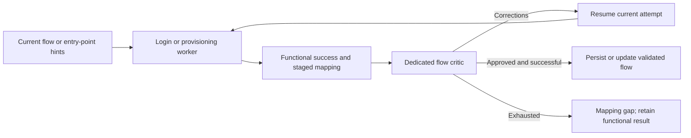
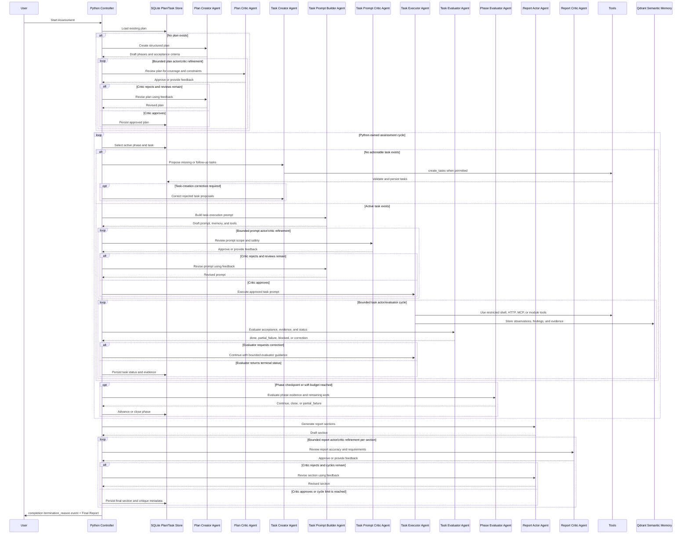
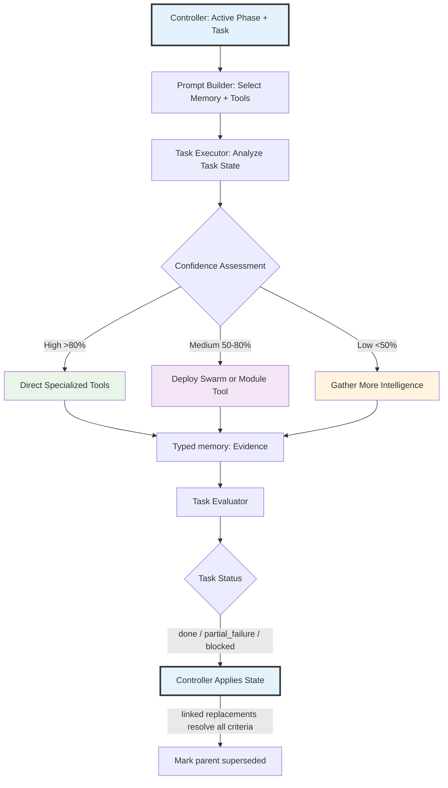
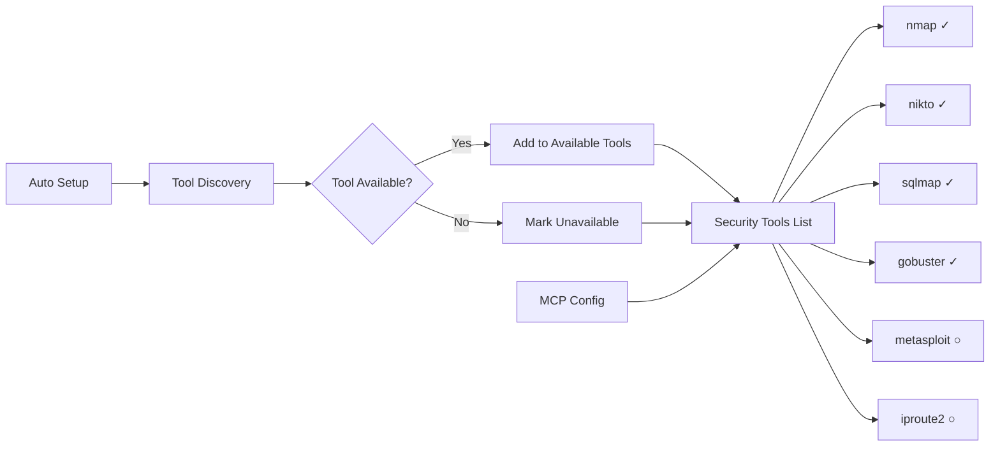
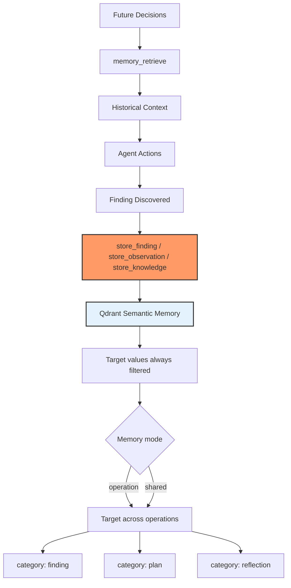

# Agent Architecture

Cyber-AutoAgent implements a **Python-orchestrated multi-agent workflow** using the Strands framework for autonomous security assessment.

Web search uses DDGS with `backend="auto"`, delegating engine selection and fallback to the library.
The application retains its existing retry wrapper, sensitive-query checks, and semantic result cache.

## Design Philosophy: Python-Owned Workflow, Focused Agents

The core design philosophy centers on deterministic Python ownership of workflow state with short-lived agents assigned to narrow, well-defined roles.

### Why Python-Owned Orchestration?

Long-lived autonomous conversations tend to accumulate stale assumptions, lose context, and mutate plan/task state inconsistently. Cyber-AutoAgent keeps the durable operation loop in Python:

- plans, phases, and task statuses are stored in SQLite
- Python chooses the active phase and task
- Python applies task and phase evaluator decisions
- Python controls budget-aware phase progression
- agents handle reasoning, prompt tailoring, task execution, task creation, and evaluation

### Focused Agent Roles

The controller creates agents for specific jobs:

- **plan_creator**: creates or revises an initial high-level plan and infers operation-wide constraints
- **plan_critic**: reviews an initial plan and either approves it or returns actionable revision feedback
- **task_creator**: creates concrete current-phase tasks with finite acceptance contracts from a deterministic
  controller prompt, except for modes such as `hypothesis_dependent` that construct tasks directly in Python
- **task_prompt_builder**: reviews core, optional-tool, and installed shell-command catalogs, then selects applicable
  memory, optional tools, and likely commands for one task
- **task_prompt_critic**: approves a proposed task execution prompt or returns actionable revision feedback
- **task_executor**: executes one active task objective and retains its conversation across critic-guided passes
- **task_evaluator**: reviews semantically complete acceptance ledgers and returns `done`, `partial_failure`, or `blocked`
- **phase_evaluator**: returns phase status: `continue`, `done`, `partial_failure`, or `blocked`

Task-creation repair distinguishes schema validity from controller approval. Proposal-local rejection
diagnostics identify an index: that proposal remains editable while unaffected proposals retain their
previous values and positions. Batch-wide or unindexed rejections unlock the complete batch, including
its proposal count. Every retry is fully revalidated before any task is persisted. Repeat detection
compares the current effective submission, including corrections preserved by the repair guard.

Module execution guidance supplies operation intent, explicit access boundaries, domain behavior, and evidence rules to
planning and execution roles. The module termination policy, including any advisory recommended minimum phase contract,
is also supplied directly to plan creation, plan criticism,
plan revision, and phase evaluation so required end states become measurable plan criteria. A controller-owned executor
contract keeps individual workers scoped to one task regardless of module.

Each task also has an immutable acceptance manifest. Procedure bases declare machine-readable limits and whether they
produce a generic artifact or versioned inventory manifest; coverage bases freeze one inventory artifact and its hash.
Executors submit an atomic evidence-backed result for every criterion and, for coverage work, one terminal disposition
per manifest item. Python resolves typed artifact, memory, observation, and finding evidence before semantic
evaluation. This preserves broad, cohesive work under one retained executor without allowing moving completion
targets.

### Replacement and Supersession

When a task cannot complete and its remaining intent must be split or retried as new work, replacement tasks declare
`replacement_of` with the parent task UID and identify the parent criteria they resolve in `supersedes_criteria`.
Python reconciles this lineage before phase closure. The parent becomes `superseded` only after every parent criterion is
covered and every linked replacement is `done` or `superseded`. The parent record, evidence, and failure reason remain
available for audit. Unlinked failures remain blocking, and Python does not infer replacement relationships from
similar wording.


The swarm tool remains available as an execution capability, but it is no longer the top-level orchestration model.

## Core Architecture



## Strands Tools

Agents operate through role-specific restricted tool lists.

### Primary Tools
- **shell**: Execute system commands (nmap, sqlmap, custom scripts)
- **editor**: Create/modify files and custom tools
- **swarm**: Deploy parallel agents for complex tasks
- **http_request**: Make HTTP requests for web testing
- **memory_list / memory_retrieve**: List or semantically retrieve findings and knowledge
- **load_tool**: Dynamically load created tools
- **create_tasks**: Create durable follow-up tasks from task executors when permitted

Plan/task state transitions are owned by Python workflow code. Task creators return schema-validated `TaskProposal`
payloads, which Python validates and persists without an agent tool call. Task executors may still add contracted
follow-up work with `create_tasks` when permitted. Active task context is injected into the role prompt by the workflow;
agents do not fetch it with a tool.

Planning, prompt-building, evaluation, taxonomy, reporting, and evaluation-policy roles use provider-backed structured
output schemas. Strands lets LiteLLM and Bedrock select native response schemas or their internal tool fallback. When
any provider/model cannot complete that protocol, the controller records an operation-local capability downgrade and
uses bounded, schema-validated JSON repair for later structured roles in the same operation. Schema validation and
ordinary provider failures retain their normal bounded-retry behavior rather than triggering this compatibility path.

There is no agent-callable stop tool. When Python workflow evaluation determines the assessment is complete, the controller emits a `termination_reason` event with reason `complete`.

Generated plan constraints are durable workflow guardrails. Task creation and prompt-building roles must honor them,
and task/phase evaluators prevent successful completion when evidence shows a constraint violation.

Initial plan generation uses a bounded actor/critic cycle before persistence. Critic approval immediately accepts the
current draft; rejection sends feedback to `plan_creator` for revision. The
`CYBER_WORKFLOW_PLAN_REFINEMENT_ITERATIONS` environment variable limits reviews and defaults to seven. A rejection on
the final configured review fails the workflow so an unapproved plan is never persisted or executed.

Task prompt generation uses the same bounded pattern. `CYBER_WORKFLOW_TASK_PROMPT_REFINEMENT_ITERATIONS` defaults to
three critic reviews and accepts `0` to disable critique. After JSON retries, malformed or unavailable builder/critic
output and non-scope prompt defects that survive one bounded repair use a deterministic controller task template.
The template has no model-selected optional tools or shell commands, and selects only canonical memory references.
The controller emits `task_prompt_fallback` for that recovery. Only a valid critic response explicitly identifying a
hard target-scope violation marks the active task `partial_failure` without invoking its executor or evaluator.

Login and provisioning workers discover flows while completing their assigned action. Dedicated flow critics
review staged metadata and current-task evidence; only successful, approved flows are persisted. The worker keeps
its browser progress and identity across corrections. Successful login or registration remains usable if metadata
review cannot approve a reusable mapping. Authentication recovery permits one additional functional worker
pass before recording a gap.
Browser capture tries up to eight distinct observed credential-bearing GET requests and requires an
anonymous/authenticated difference. Repeated failed capture inputs require new browser evidence or corrected
metadata. Successful capture saves a secret-free proof artifact; controller validation supersedes earlier
recorder output in flow reviews. Session freshness remains checked before reuse and requests.
Initial metadata recording precedes up to three critic reviews,
with repairs between rejected reviews. After functional success, repairs use only observation and recording
tools. Review events and persisted gaps include the review count and stopping reason; a completed identity
or session does not imply an approved reusable flow. See [credential workers](#credential-workers) for the execution sequence.

| Variable | Default | Description |
|----------|---------|-------------|
| `CYBER_WORKFLOW_FLOW_REFINEMENT_CYCLES` | `3` | Maximum flow-critic reviews per attempt; minimum one. Initial recording does not consume a review. JSON retries are separate. |
| `CYBER_WORKFLOW_FLOW_REFINEMENT_SEARCH_LIMIT` | `16` | Searches per worker invocation or per distinct authorized artifact for critics; minimum one. |

Artifact errors explain the exhausted read or search allowance. Critics synthesize from returned evidence when
access is exhausted; JSON repair and one transient retry keep artifact access closed. Approval still requires
current-task evidence selected by the critic. These retries do not consume semantic correction cycles.

Task execution then uses a second bounded actor/critic loop:



`CYBER_WORKFLOW_TASK_EXECUTION_CYCLES` limits executor attempts to produce a valid atomic ledger, defaults to three,
and has a minimum of one.
while `CYBER_TASK_ACCEPTANCE_MAX_CORRECTIONS` independently limits rejected acceptance repairs to two after the initial
submission. Repairs retain the executor conversation and stop early when an equivalent rejected payload is repeated.
Once that ledger exists, the evaluator's semantic verdict is terminal because the ledger cannot
be revised. Python persists `done`, `partial_failure`, or `blocked` without replaying completed acceptance.

Task creators return one typed proposal batch, after which Python applies the existing preflight, deduplication, and
durable persistence checks. Rejected batches remain correctable within the configured bound. Task executors stop after
a complete `record_task_acceptance` result; rejected calls remain correctable.

The task prompt builder uses the frozen task and acceptance contract to describe only the assigned execution steps.
Python appends the full acceptance contract and operation constraints to the approved executor prompt. Authentication
setup runs between prompt approval and task execution; an assigned unauthenticated baseline remains executor work.
Cookie and Authorization header restrictions follow their stated operation and target scope. The prompt critic reviews
the draft against this assembled context and does not require it to repeat controller-owned rules. The builder and
critic see the controller-supplied task tools, including authenticated-context refresh when authorized; the critic's
tool catalog uses the same resolver as execution. Controller-supplied tools are not optional-tool selections.
Automatic task prompt memories are limited by controller-owned task, target, and frozen inventory-item provenance;
unscoped observations and findings remain available through explicit retrieval rather than appearing in every task
prompt. General unscoped knowledge can still guide task planning. Prompt memory catalogs show provenance alongside
each selected item. Before authentication setup, prompt builders cannot supply credential IDs. After setup, executors
may use controller-validated opaque IDs in authorized tool calls and durable evidence when acceptance requires ID
binding, while keeping secret credential values out of reportable material. For self-registration, the recorder's
legacy `login_url` argument carries the mapped registration URL; a success redirect is recorded only if observed.

Every role invocation also has deterministic safety bounds. Three consecutive responses without a new tool action stop
a required-tool role as stalled, regardless of tool calls or reasoning emitted during an earlier actor cycle. An
absolute controller-to-agent call ceiling bounds repeated invocations, while the Strands SDK `turns` limit bounds model
calls and tool executions inside each invocation. Task-executor actor cycles allow 8 agent calls with 32 SDK turns per
call, bounded tool-recovery runs allow 4 calls with 8 turns, and task creators allow 3 calls with 6 turns.
No-action redirection prompts respect the role policy: roles that disallow text completion are instructed to call an
outstanding required tool and are never offered a text-only final-answer path. Task executors instead receive a
task-progress redirect because their required acceptance tool is a completion condition: they call the next tool needed
for unmet criteria and durable evidence, then submit acceptance after its prerequisites are complete.

Bounded procedure contracts declare whether their output is a generic artifact or a version-1 inventory manifest.
Python rejects mismatched evidence requirements during task creation. Inventory executors receive the canonical JSON
shape in both their task prompt and acceptance-tool description, and acceptance validation evaluates each referenced
artifact independently so an unrelated supporting file cannot invalidate a separate valid inventory.

Each retained task executor also keeps a bounded controller-owned tool-outcome journal. A locally correctable failure
permits prerequisite inspection or creation, independent work, alternative methods, and two changed retries by
default. Structured memory and acceptance validation errors enter the same correction path. Identical failed calls are
blocked locally, and equivalent failures are counted across retained executor cycles so conversation boundaries cannot
restart an unbounded loop. Recovery does not lock unrelated tools or durable evidence operations.
Generic executable startup and dependency failures quarantine only that executable for the current operation; later
task prompts omit it while capability-compatible commands remain available. An unresolved correction is
deterministically `partial_failure`. Evaluators receive the authoritative outcome journal separately from the worker's
final narrative and must prefer it when the two conflict. Failed diagnostic and preflight shell commands remain visible
in the journal but do not start recovery.

Shell-tool discovery first resolves each configured command on `PATH`. A tool may optionally declare a side-effect-free
`canary` object with `args`, `timeout_seconds`, and `accepted_exit_codes`; successful canaries mark tools verified.
Commands without a safe standalone canary remain available but unverified. The Docker tools-image verifier implements
the same configuration contract independently and is not imported by application runtime code.

Task creation similarly has a deterministic structured-output boundary. After an initial rejected proposal, the
controller may request up to `CYBER_TASK_CREATOR_MAX_CORRECTIONS` corrected payloads (six by default). The initial
prompt contains stable phase context and corrections contain only the prior validation error. Agents submit a flat
`TaskProposal` whose `limits` object is always required. Python discards it and `output_kind` for snapshot work,
infers the basis, supplies procedure invariants, derives source references and target scope, and compiles the proposal
before storage. Inventory-wide moving collections are rejected as procedures and must use frozen snapshot references.
Exact frozen-contract duplicates are skipped deterministically within the active phase; completed coverage from one
phase does not suppress work against the same snapshot in a later phase. Unfinished coverage retries remain eligible,
and duplicate-only payloads remain eligible for a bounded corrected submission.

Successful task acceptance populates task evidence with the validated immutable ledger references. Phase
evaluators receive that canonical per-criterion ledger and may read only its resolved artifact paths, preventing stale
predicted filenames from overriding accepted evidence. Task creators use a closed flat schema with explicit limits,
criterion descriptions, snapshot references, and target IDs. Python generates readable unique criterion IDs and
evidence requirements and owns the remaining contract and lifecycle fields.

Before an acceptance ledger is persisted, controller validation copies artifact evidence into a task-owned immutable
path within the operation root. Independent inventory-producing tasks therefore cannot overwrite one another's
accepted outputs. When a following phase consumes multiple completed inventory manifests, Python creates one merged,
provenance-preserving snapshot for fan-out. A manifest is not valid proof for a task frozen to a single inventory
subject; that rejection occurs before ledger persistence. Prompt-memory selectors are advisory: stale IDs or indices
are logged and dropped while valid selected context remains available to the executor.

A testing phase that depends on hypotheses creates tasks only for inventory groups with completed, validated
hypothesis deliverables. Each `record_hypotheses` call may publish a non-empty subset of assigned subjects. A
resubmitted subject accumulates distinct hypotheses by default (`mode="append"`). Exact duplicates are idempotent,
including repeated entries for a subject within one call. To correct or remove hypotheses, use `mode="replace"`
with that subject's complete corrected list; omitted subjects remain unchanged. Conflicting dispositions in one
submission fail atomically. Appending hypotheses replaces a no-test disposition; clearing existing hypotheses
requires explicit replacement with a reasoned no-test disposition.
Every successful call produces an immutable cumulative `hypothesis_set_v1` artifact. Python supplies operation,
producer, frozen assignment, and hypothesis IDs. The result includes `artifact_ref`, `sha256`, cumulative
`subject_ids`, `published_subject_ids`, `missing_subject_ids`, `hypothesis_ids_by_subject`, and `hypothesis_counts`.

Task recovery metadata stores ordered `hypothesis_publications` digest bindings in SQLite. The latest cumulative
snapshot is authoritative; older snapshots remain provenance and cannot substitute for missing or corrupt current
output. Publication reloads durable state between calls and actor cycles. Every assigned subject must have testable
hypotheses or a reasoned `no_testable_hypotheses` disposition before successful acceptance. The contract is
protocol-neutral: HTTP endpoints, network services, and source/filesystem subjects use the same reasoning fields.
No supported hypothesis is a successful outcome, not a coverage gap or a claim that no vulnerabilities exist.
Accepted no-hypothesis subjects do not generate downstream testing tasks. If all relevant subjects have accepted
no-hypothesis dispositions, dependent testing is not applicable. Mixed subjects generate tests only where a
hypothesis exists. Missing optional metadata does not require speculation; explicitly required unavailable
evidence remains a prerequisite gap.

Supporting references must be existing current-operation `artifact:` or `artifact_id:` references. Unsupported
kinds and missing files return the subject, field, offending reference, and correction. Memory context is advisory;
cite its underlying artifacts. Availability does not establish semantic support. Positive expectations must
distinguish the suspected weakness from normal functionality; capability discovery alone is not vulnerability
validation. The evaluator assesses that distinction, while Python owns availability and provenance checks.
The evaluator receives every record from the latest validated publication in a controller-generated TOON index.
Historical publications and acceptance summaries cannot establish current coverage. Semantic revisions retain
the publisher and use explicit replacement without executing future tests. Satisfied execution receipts cannot
override a rejected hypothesis review.

The bound `record_task_acceptance` tool automatically attaches the latest complete cumulative artifact to submitted
`evidence_refs`, preserving the actor's status, disposition, summary, and other evidence. Missing subject IDs are
reported directly. Publication alone never invents semantic acceptance. Historical missing-reference rejections
may replay the retained acceptance through the same validation path. Other failures retain the rejected submission,
error, publication reference, and missing subjects across cycles so repair does not restart inventory discovery.

Recovery selects production or acceptance mode from the validated cumulative publication, not successful input
reads or the absence of execution requirements. Missing, partial, or invalid output retains the approved production
tools, including the publisher, during ordinary and tool-policy recovery. Fresh producer cycles carry frozen source
references and subject IDs separately from completion evidence, plus publication state and rejected submissions.
Optional metadata gaps do not require repeated searching: the actor publishes supported hypotheses or a reasoned
no-test disposition. Only complete validated output permits acceptance-only closure. Workflow logs record the mode
and missing subjects. The bounded invocation loop guard also detects interleaved repeats of identical successful
artifact reads/searches; different paging arguments and search patterns remain distinct calls.
Complete assigned inventory records are saved under `artifacts/hypothesis_context/`, keyed by frozen source refs,
digest, and subject IDs. Source fingerprints invalidate changed inputs. Compact records are supplied to builders,
critics, and actors; oversized attributes remain available in the complete saved artifact. A task-local filesystem
ledger retains the last 24 distinct successful inspection arguments and returned references across cycles, without
retaining response bodies. These inputs are investigation context, never execution proof. No new global read limit
or process-wide in-memory cache is introduced.

No database migration is needed. Older unreleased singular bindings are invalidated and use the existing producer
repair path; historical acceptance ledgers are not rewritten.

Consumers receive only bound hypothesis output references, producer IDs, digests, and a compact subject index;
supporting inventory inputs remain separate. `read_hypotheses` validates the binding and frozen assignment on every
bounded subject read. Older producers without valid output get one deduplicated repair task per original producer
and frozen contract. The original completed task and its acceptance ledger remain unchanged. Testing waits for
validated repair output or records an explicit prerequisite coverage gap.

Phases declaring `task_creation_mode: hypothesis_dependent` use controller-owned task construction.
The nearest preceding phase declaring `produces_hypotheses: true` supplies validated publications;
phase numbers and titles do not select this behavior. Python partitions each atomic inventory group by
the hypotheses' explicit `authentication_requirement`, compiles snapshot proposals through the shared
task compiler, validates the complete batch before persistence, and binds each task to its assigned
hypothesis IDs and publication digests. No task-creation agent runs for this mode. Execution prompts,
prompt critics and executors still choose suitable tools and reason about outcomes. Consumers paginate
only assigned hypotheses. Changed or unavailable publications invalidate those bindings. Stable assignment
keys prevent duplicate tasks on continuation. Subjects with reasoned no-hypothesis dispositions create no
testing tasks; a completely assessed inventory with no hypotheses makes testing not applicable.

Every hypothesis declares `authentication_requirement`, using the same contract as task planning:
`{"comparison":"none","roles":[]}` requests unauthenticated execution; one declared role with
`comparison: none` requests one session. Account, role and tenant comparisons request additional identities
only where needed. Roles must be declared for the assigned operation targets. Missing metadata is not
inferred from prose or silently treated as unauthenticated; existing producer repair preserves the original
completed publication and acceptance ledger.

Producer and critic guidance considers unauthenticated attack paths alongside applicable authenticated
and identity-comparison scenarios. Authentication requirements describe execution rather than limiting
hypothesis generation to authenticated work. The critic requests targeted repair when frozen observations
support an overlooked unauthenticated scenario. No additional coverage field or automatic unauthenticated
counterpart is required; a reasoned no-hypothesis outcome remains valid. Unauthenticated assignments
retain empty roles and require no credential sessions.

After 16 exploration calls without a new publication digest, the after-tool hook returns a normal
publication checkpoint. Shell and other exploration calls count; duplicate publications and observation
writes do not reset progress. A bounded publication turn reuses retained filesystem inputs and inspection
context. If publication remains incomplete, the critic identifies a frozen criterion, missing required input,
affected subjects and frozen source references. Further inspection is restricted to those input artifacts
through a paginated, source-bound reader. Optional missing metadata does not justify further inspection.
Unrecoverable prerequisites close as blocked. These turns remain inside the configured actor/critic cycles
(three by default); they do not introduce a global artifact quota.

Hypothesis critics return the latest publication digest and exactly one retain, revise or withdraw decision
with reasons for every current subject and hypothesis. Python checks review coverage and provenance; the
critic assesses observed versus conditional preconditions, meaningful controls and security impact.
Availability, versions, absent headers or normal output alone do not establish impact. Revisions use an
explicit publication repair and replace a subject's complete corrected list while preserving unaffected
records. An explicit `repair.kind: none` remains terminal even with explanatory instructions.

The same fields describe each module's native actions; subject identity comes from the frozen inventory:

| Subject | Attacker-controlled input/action | Safe test and control |
|---------|----------------------------------|-----------------------|
| HTTP endpoint | Query parameter | Compare a harmless probe response with an unchanged parameter control. |
| Network service | Protocol frame field | Compare two bounded protocol exchanges and save both responses. |
| Source/filesystem component | Data read from a configuration file | Trace the input to its consumer and compare isolated fixtures. |


The hypothesis phase persists its verified source inventory manifest in plan metadata before its execution cap check.
On older plans, the controller reconstructs that binding from valid task assignments or a completed inventory
producer. This lets the dependent phase measure missing coverage even when the hypothesis phase has no task records.
If a hypothesis phase reaches its cap before covering every group, the controller records the uncovered groups,
continues testing covered groups, and reports the remaining coverage as an incomplete assessment. With no completed
hypotheses, the dependent phase closes as a partial failure without creating generic testing tasks. If no verified
source manifest is available, it records a prerequisite gap and also closes as a partial failure.

### Authentication design goals and decisions

This section records the rationale for credential workers and flow review. Future changes should preserve
these goals and use the credential-worker tests as regression checks.

- **Discover through execution.** Provisioning and login workers learn the complete flow while performing
  their assigned action, including multi-step forms. An existing flow is a starting point that can be corrected.
  Separate discovery agents cannot reliably establish that an account was created or a session works.
- **Separate completion, freshness, and mapping approval.** Successful account creation or login is a durable
  fact; session freshness determines whether requests may run; critic approval determines whether a reusable
  mapping may be published. Metadata rejection or expiry during review must not repeat a successful action.
  Historical login completion must never substitute for a fresh session.
- **Keep proof and provenance in Python.** The controller binds task scope and credentials, correlates outcomes,
  saves validation proof, and checks critic references. HTTP success and readable artifacts establish availability,
  not authentication. Reusable HTTP contexts require a credential-dependent difference from anonymous access.
  Visible signed-in SPA controls alone do not prove that replaying their public HTML route authenticates requests.
  Login workers attempt context capture after successful browser navigation and actions. Incomplete capture
  allows multi-step interaction to continue; successful validation stops further authentication actions.
  Navigation saves the rendered DOM, and reviews retain cumulative current-task evidence across worker sessions.
- **Persist instructions independently of artifacts.** SQLite flow descriptors survive across operations.
  Loading a validated flow does not require its original files. Historical references and approval digests
  are excluded from replay instructions and cannot authorize current proof; Qdrant memories remain advisory.
  Reuse requires live execution with current-operation evidence. Approved repairs update the existing flow;
  unsuccessful repairs preserve the previously validated descriptor.
- **Support application-defined credentials.** Cookies, arbitrary named headers, and configured storage bindings
  may be used together; token formats are not restricted to JWT. User-provided API keys and header values use
  direct validation, with no login or self-registration requirement.
- **Preserve credential isolation.** Each worker uses one selected credential or generated registration identity
  throughout retries. Completion and proof from one account cannot establish another account's session.
  Tasks use one account unless their declared comparison requires two independent accounts and sessions.
- **Review the applicable contract.** Critics review the bound recorder's editable fields and observed evidence.
  Controller validation supersedes earlier recorder output and cannot be repaired by an actor. Browser labels
  may contain Unicode or emojis; backend payload names are not mandatory. Unknown transport details remain
  empty, and requiredness needs rendered constraints or observed validation.
  `request_header_names` describes credential transport on authenticated requests, including headers first used
  after login. It is not limited to login-submission headers. Controller-proven header names are authoritative.
- **Bound recovery without weakening proof.** Context capture tries at most eight distinct observed requests.
  Identical failed capture inputs require new relevant browser evidence or corrected metadata before replay.
  Authentication gets one functional recovery pass; completed flows get three critic reviews by default.
  After success, actors receive only observation and recording tools, preventing repeated login or registration.
- **Keep model guidance concise.** Tool errors explain missing evidence, failed replay, and indistinguishable
  responses. Python performs deterministic selection and bookkeeping; agents reason about observed application
  behavior. Avoid target-specific paths, fixed header assumptions, and expanding prompts with incident details.

### Reasoning replay and emergency context recovery

Every model request receives a generation allocation from its assembled input, resolved context capacity,
required answer space, configured reasoning allowance, and a safety margin of the larger of 512 tokens or
2% of context capacity. Role `max_tokens` values are preferred targets; explicit `MAX_TOKENS`,
`MAX_COMPLETION_TOKENS`, provider configuration ceilings, and known model output limits remain hard caps.
Required structured records determine answer capacity; an input inventory does not imply one output per item.
Unstructured calls reserve at least the smaller of 1,024 tokens or their preferred target for an answer.

The controller first reduces optional input and eligible conversation content toward the preferred target,
then permits a smaller generation allocation when the complete-answer and reasoning minimum still fits.
Otherwise it raises an explicit capacity error before calling the provider. Allocations are recalculated
after tool results, continuation, repairs, and reduction, so temporary capacity pressure cannot permanently
lower the target. Genuine output truncation can request a bounded 2,048-token retry increase; reasoning-loop
recovery retains its separate policy. These adjustments are local to the invocation.

Final transport adapters cover streaming and native structured output, including direct SDK summaries and
evaluation prompts assembled by Ragas. SDK summaries use a target of at most 4,096 tokens and an independent
answer floor, preserving the parent task's allocation. Provider request settings and output reservations
are applied together on request-local model copies. Diagnostics record capacities, allocations, caps, and
allocation reasons without recording prompt content. Existing operation budget and termination rules apply.

Reasoning generation and reasoning replay are separate behaviors. Ollama may generate fresh thinking, which
remains available in diagnostics, but prior reasoning blocks are excluded from subsequent requests and input
estimates. LiteLLM retains its existing no-replay policy. Replay-enabled providers retain the complete latest
reasoning-bearing assistant message, including signatures or redacted blocks, across a following tool result;
context reduction temporarily pins that turn and preserves its tool exchange.

Recent-message preservation is advisory for oversized tool payloads. If ordinary reduction cannot fit the input,
the controller archives eligible recent tool results under `artifacts/context_reduction/<sha256>.json`, then
replaces inline content with a bounded preview and retrieval reference. The original payload must be saved
successfully before replacement. Structured acceptance and provenance records, task instructions, tool schemas,
and required reasoning remain protected. A preview establishes no semantic evidence conclusion; omitted content
must be retrieved before relying on it. Archiving preserves the current output reservation; the allocator
may subsequently reduce it toward the complete-answer minimum. If protected input still cannot fit, the controller raises an explicit capacity error and logs fixed input, remaining messages, and output reserve.

### Credential workers

Authentication and provisioning workers discover flows during authorized interaction. There is no separate
observation-only discovery prerequisite. A current-version completed flow is supplied as a starting point;
otherwise, the worker uses target-scoped entry-point hints. Workers may correct the mapping and follow observed
connected steps within assigned origins, while retaining the selected credential or registration identity.

Worker-bound recorders stage secret-free descriptors, including ordered `steps` with observed routes, action kinds,
and field names. Python binds the task and operation and checks active task scope on recording. Browser context
capture uses staged header metadata instead of requiring a persisted flow ID. Credential access still requires
one active task, and credentials and session values are never included in reusable descriptors.

Dedicated `authentication_flow_critic` and `registration_flow_critic` agents review current-task observations and
select `supporting_evidence_refs`. Python validates their selection and computes approval digests. Authentication
publication requires completed opaque-context validation, even if that context expires during metadata review;
registration publication requires a successful credential-storage call whose durable metadata confirms a
registered credential for the assigned target and role. Only approved,
successful flows are stored as validated records. Corrections update an applicable existing record instead of
creating duplicate unreviewed descriptors. Authentication version 10 and registration version 4 are accepted;
older versions and discovery settings have no compatibility path.

After functional completion, the flow critic performs up to three reviews, with metadata repairs between
rejections. Initial recording does not consume a review. Authentication permits one functional recovery pass
after an unsuccessful initial worker; failed recovery records a gap without invoking a flow critic.
Corrections continue from the browser and retained outcomes. Every functional repair retains its worker run policy. Invocation-local tool hooks check controller-owned
completion after each result and cancel remaining queued calls before execution. Login ends at a validated
context or definitive credential rejection; provisioning ends when the task-bound registered credential is
durably stored. Metadata repairs end at flow staging, returning control to the critic. Terminal reasons survive
the executor result boundary and appear in worker completion logs.
After functional success, the controller supplies only observation, artifact, and flow-recording tools for repairs,
preventing another login or account creation. A definitive credential rejection stops the attempt. Exhausted flow
review retains functional credentials and contexts and records a mapping gap; provisioning task evaluation remains
separate. Unknown transport details may remain empty for browser mappings, while multi-step mappings retain their
observed sequence.
Task proposals declare `authentication_requirement` separately from established `auth_context`:
`{"comparison": "none", "roles": ["member"]}` requests one account per assigned target and required role.
The default is `none` with no role filter, which selects one eligible account per assigned target.
An unauthenticated baseline adds no credential requirement. Explicit `account`, `role`, or `tenant` comparisons
select a qualifying pair from recorded identity metadata; distinct credential IDs alone do not prove distinct accounts.
Web and web-recon module contracts declare `authentication_matrix_workstreams`. Python expands each scoped
template using target-scoped roles from credential metadata (including unavailable credentials) and structured
registration flows. Role applicability is independent of credential and session availability.

| Comparison | Expansion | Credential requirement |
| --- | --- | --- |
| Unauthenticated versus role | Once per defined role | One account for that role |
| Same role, different accounts | Once per defined role | Two distinct accounts sharing the role |
| Different roles | Once per unordered pair of defined roles | One account from each role |

An application with one defined role has no different-role tasks and no coverage gap for their absence.
Missing credentials for an applicable comparison remain an execution gap. Controller-owned HTTP comparisons
retain anonymous and authenticated responses, reusing matching current-operation baseline evidence when possible;
response differences alone do not establish a vulnerability. Non-HTTP modules can opt into the same declarative
matrix without browser or HTTP assumptions. Explicit tenant comparisons retain their existing selection contract.
On continuation, unfinished inherited templates and contradictory role-selection failures are superseded by
applicable comparison tasks. Frozen inventory subjects are preserved; completed work and frozen validation
credential bindings are retained. Reconciliation is idempotent. Identity availability is checked before executor
prompt construction, and error events retain the requested comparison and roles.
Python persists requirements during task fan-out, prefers valid sessions, and authenticates only selected identities.
Session reuse and authenticated requests enforce a 600-second safety window for known JWT and cookie expiry.
Material with less than 600 seconds remaining requires refresh; unknown expiry still requires behavioral validation.
One alternate selection is allowed after failed setup; frozen finding-replay credentials are never substituted.
The two-account provisioning pool remains available without logging both accounts in for every task.

The controller stores secret-free completion facts in SQLite-backed task recovery context: credential identity,
task and operation provenance, supporting artifacts, and separate functional and mapping states. Registration
acceptance is recorded directly from a successful task-local storage result and the matching persisted credential.
A module-specific reconciliation callback corrects contradictory acceptance submissions before publication to
memory. Fresh continuations and evaluators receive these facts without rereading registration artifacts. Restored
facts are checked against current credential or authenticated-context state. A successful login proves only its
credential setup, not unrelated criteria of its parent task; mapping failures remain separate from functional success.
Classified inventory authentication routes and validated registration redirects are scoped navigation hints,
without inferred flow kinds or authentication proof. Current controller header mappings take precedence over
stored mappings and are shared by prompts, flow staging, and context capture. Provisioning storage binds target,
role, and registered origin in Python. Registration step field names describe observed controls; required and
optional classifications need supporting evidence, with unknown classifications omitted.
Every agent event handler has a passive outcome recorder sharing its journal. SDK priority captures original
results before recovery callbacks rewrite them. Worker sessions expose task-local outcome snapshots, and the
controller retains those outcomes across review corrections.




Task prompt builders and critics receive a compact plan projection, applicable phase metadata, the assigned contract,
and status counts with at most five related task summaries. Their initial requests and retries are measured using
model-aware token estimates, including system instructions, tool/output schemas, and the current output allowance.
Python aims for 80% of input capacity by reducing advisory history, memory candidates, and catalog descriptions in
that order. Runtime tool names remain available, selected memory context and selected input schemas remain intact,
and required scope and acceptance content are never truncated. An irreducible overflow produces a diagnostic before
inference and uses the existing deterministic fallback where eligible.

Authentication analysis keeps route classifications in `candidate_mechanisms` and response-backed structural
indicators in `observed_indicators`. The legacy `summary.mechanisms` field includes only supported protocol
indicators: structured OIDC/JWKS documents, SAML metadata/messages, JWT structure, or OAuth authorization redirects.
Observed indicators link to saved response artifacts. Cached protocol observations are reused only when those
responses are readable within the current operation and their body digests and response metadata still match.
Cookies and password forms remain observed indicators without establishing a protocol or validated flow.
Protocol step descriptions are hypothetical; executable flow approval and login validation remain separate.

Identical inputs reuse both successful approvals and terminal failures across continuations. Changed inputs create a
new prerequisite linked to its predecessor; an explicit failed-task reset makes the existing prerequisite eligible
to run again. Superseded failures remain archived for audit, and successful retries clear the consumer's current gap.
Missing or changed approval artifacts and ineligible flow lifecycle status invalidate reuse. Budget
interruptions leave the prerequisite unfinished rather than caching a failure. Discovery keeps its existing actor/critic
cycles (three by default), transient retry, JSON repair, and bounded artifact-access recovery.

Web authentication coverage and web-recon access-context fan-out omit static asset routes only after a bounded,
credential-free same-service GET confirms a 2xx response with a static media type. The controller records excluded
inventory IDs and response metadata in an operation artifact; uncertain responses stay eligible, and the assets remain
in the frozen inventory for later phases.

Execution requirements remain frozen in the task contract, but execution proof is controller-owned. The controller
matches successful task-local tool capabilities and normalized subjects to durable current-operation artifacts when
the executor submits acceptance. If proof is missing, Python retains the semantic acceptance payload, permits one
bounded repair against the exact missing requirement, and replays acceptance without another model bookkeeping call.
Merged phase inventories use content-addressed immutable paths and union complementary protocol-neutral interaction
metadata so later task creation cannot mutate an earlier frozen snapshot or discard methods and inputs.

Complete task acceptance also publishes one bounded operation observation containing the task objective, criterion
statuses, concrete summaries, evidence references, and aggregate coverage counts. Publication is replay-safe and lets
later task-prompt-builders select accepted information by memory ID. A memory-backend failure is reported in the tool
result but does not invalidate the immutable acceptance ledger or add an undeclared evaluator requirement.

There is also no prompt optimizer tool, prompt rebuild hook, or stalled-loop conversation rebuild fallback. Prompt
adaptation is workflow-native: prompt-builder agents receive current plan state, active phase/task context, compact task
history, memory summaries, and selected optional tool candidates. Python enforces proportional phase budget caps before
task work and handles separate advisory checkpoints before pending task activation.

### Security Tool Access

Security utilities are normally reached through the restricted shell capability. The active role receives only the
capabilities allowed for its task, and command output is captured as operation evidence.

### MCP Tool Access

MCP tools can be accessed as direct tools, but they are optional tools. They are selected per worker role and task objective, not included in every worker's core tool list. The controller can also add built-in optional tools from structured task-contract output and evidence requirements. For an inventory-manifest task, this includes the converter and the available direct recon/auth producers. This deterministic selection supplements the prompt-builder's choices and never derives tool access from task prose.

## Execution Flow



The actor/critic loops are bounded by separate configuration values: plan refinement, task-prompt refinement, task
execution cycles plus evaluator corrections, and report refinement cycles. The controller remains the source of truth for
state transitions; agents propose plans, prompts, evidence, evaluations, or revisions but cannot directly activate or
close phases and tasks.

## Role-Agent Reasoning

Focused agents still use the Cyber-AutoAgent methodology, module guidance, confidence updates, and evidence standards. The difference is that role prompts constrain the scope of each agent.



**Key Principles:**
- **Python State Authority**: Controller owns phase/task transitions and plan completion
- **Focused Reasoning**: Agents receive narrow role prompts and task-specific context
- **Metacognitive Awareness**: Agents assess confidence within their assigned objective
- **Dynamic Capability Expansion**: Workers can use shell, selected tools, and swarm when appropriate
- **Centralized Memory**: Discoveries flow into Qdrant and reports query operation-scoped evidence

## Tool Hierarchy

Based on confidence, task complexity, and role-specific tool selection:

1. **Specialized Security Tools** (via shell)
   - When vulnerability type is known
   - High confidence scenarios
   - Direct exploitation

2. **Swarm Deployment**  
   - Multiple approaches needed
   - Medium confidence
   - Parallel reconnaissance

3. **Meta-Tool Creation** (via editor + load_tool)
   - Novel exploits required
   - No existing tool fits
   - Custom payload generation

## Environment Discovery



Tools discovered via `which` command:
- Available tools accessible via `shell`
- Unavailable tools noted but not usable
- Dynamic discovery adapts to environment

MCP Tools pre-configured:
- Python reads from `CYBER_MCP_CONNECTIONS` environment
- React reads from `config.json`
- MCP Server is assigned or one or more modules

## Memory Integration



**Memory Storage**:
1. **Plans, Tasks, and Model Metrics**: Stored in `outputs/cyber_autoagent.db`, scoped by exact logical target and
   operation ID. Model metrics are append-only per provider/model capture and include their capture timestamps.
2. **Semantic Memories**: Stored in one Qdrant collection under `outputs/qdrant`, or in the configured Qdrant service.
3. **Scope**: Exact target values are always criteria; operation ID is additionally required in `operation` mode.

**Evidence Storage Format**:
```
[VULNERABILITY] SQL Injection
[WHERE] /login.php?id=1
[IMPACT] Database access, credential extraction
[EVIDENCE] Request/response pairs, command outputs
[STEPS] Reproduction steps
[REMEDIATION] Use parameterized queries
[CONFIDENCE] 95% - Verified
```

## Model Providers

### Bedrock Provider (AWS)
- **Primary**: Claude Sonnet 4.5 (claude-sonnet-4-5-20250929-v1:0)
- **Embeddings**: Titan Text v2 (amazon.titan-embed-text-v2:0)
- **Region**: us-east-1 (default, configurable)
- **Benefits**: Latest models, managed infrastructure, reliable performance

### Ollama Provider (Local)
- **Primary**: qwen3.6:27b (default)
- **Embeddings**: mxbai-embed-large:latest
- **Benefits**: Privacy, offline, no API costs, local control

### LiteLLM Provider (Universal)
- **Primary**: 100+ models supported (OpenAI, Anthropic, Cohere, etc.)
- **Configuration**: Provider-specific API keys
- **Benefits**: Multi-provider flexibility, unified interface

## Event System and UI Integration

**AgentEventHandler** extends the Strands SDK's callback system to emit structured events for UI consumers:

### Event types emitted during operation

- tool_start: Tool invocation with parameters
- tool_end: Tool completion with results
- reasoning: Agent decision-making context
- metrics_update: Token usage, cost, duration, and budget progress
- progress_update: progress updates
- operation_init: Operation metadata and configuration

Events flow from the Python agent through stdout using the `__CYBER_EVENT__` protocol, enabling real-time monitoring without tight coupling between backend and frontend.

## Evaluation System

**Automated Performance Assessment** using Ragas metrics integrated with Langfuse:

| Metric                   | Range   | Purpose                                   |
|--------------------------|---------|-------------------------------------------|
| tool_selection_accuracy  | 0.0-1.0 | Strategic tool choice and sequencing      |
| evidence_quality         | 0.0-1.0 | Comprehensive vulnerability documentation |
| methodology_adherence    | 0.0-1.0 | Defensible methodology alignment          |
| penetration_test_quality | 0.0-1.0 | Holistic assessment quality               |

Evaluation triggers automatically after operation completion when `ENABLE_AUTO_EVALUATION=true`, providing continuous feedback for system improvement.

## Key Design Principles

1. **Python-Owned Orchestration**: Durable workflow state is managed by code, not by prompt instructions.
2. **Focused Role Agents**: Each agent receives a short, defined objective and restricted tools.
3. **Soft Budget Distribution**: Phase progress is evaluated against proportional budget targets.
4. **Evidence-Focused Memory**: Findings, observations, and proof references are stored in Qdrant for retrieval and reporting.
5. **Swarm Intelligence as a Capability**: Workers may deploy specialized sub-agents when useful, without giving up controller state authority.
6. **Tool Agnostic Execution**: Shell can access installed tools, while optional MCP/module tools are selected per task.
7. **Continuous Evaluation**: Automated performance metrics support operational improvement.

This architecture enables autonomous operation while keeping workflow control deterministic, inspectable, and resilient to context loss.

# Controller-owned authenticated coverage

For web phase-3 tasks, the controller can execute authenticated credential coverage and account/role comparisons
when their frozen inventory
provides an in-scope HTTP endpoint with a recorded GET or HEAD interaction. The authentication worker establishes or
refreshes an opaque context only when needed. The controller then uses each validated, task-authorized credential ID
to request the endpoint without following redirects and stores the response with a specific gap for failed requests.
Controller comparison captures go directly to the existing semantic evaluator when explicit machine-checkable
assertions cannot establish completion. An execution worker starts only for an evidenced gap, with one bounded
corrective execution. Interactions without a safe recorded method continue through task executors. Capture-only
criteria can still complete without an evaluator. Comparisons never complete from status or body equality alone.

Inventory producers can declare typed `attributes.interaction.extensions.http_comparison` metadata for an
observed HTTP interaction (`operation_provenance: observed`). Recon consolidation validates and preserves it;
conflicting declarations disable deterministic assertion acceptance. Defaults inferred from extracted URLs carry
`operation_provenance: inferred`; neither an inferred method nor a prose success signal establishes suitability.

The version-1 contract declares a concrete `url`, `method` (GET or HEAD), `comparison` (none/account/role), nonempty
`prerequisite_evidence_refs`, and response `assertions`. Each assertion specifies an `identity` selector, `status`,
`content_type`, and nonempty `body_contains`. Selectors are `anonymous`, `account:1`, `account:2`, or `role:ROLE`.
A role selector applies to every selected credential in that role; account slots use controller selection order.
The controller binds selectors to authorized IDs, freezes current-operation prerequisite digests, and checks every
required identity against the same request. Assertions are explicit expected behavior, never synthesized from equal
responses or HTTP status. Missing assertions, changed prerequisites, or mismatches require semantic review.

```json
{
  "interface": "http", "operations": ["GET"], "operation_provenance": "observed",
  "extensions": {"http_comparison": {
    "version": 1, "url": "https://target.test/resource?id=known", "method": "GET",
    "comparison": "none", "prerequisite_evidence_refs": ["artifact:artifacts/resource-proof.json"],
    "assertions": [
      {"identity": "anonymous", "status": 403, "content_type": "text/plain", "body_contains": "Policy denied"},
      {"identity": "role:member", "status": 200, "content_type": "text/plain", "body_contains": "Known resource"}
    ]
  }}
}
```

Pending task activation recalculates execution ownership and binds this metadata without changing frozen criteria.
Active and completed tasks retain their execution assignment. `completion_review` records `capture_only`, `assertions`,
or `semantic` plus its reason; `controller_comparison_review` events expose comparison routing for operation reviews.

Captures persist with operation/task/frozen-contract bindings, selected credential IDs, and a content digest.
Continuation reuses unchanged captures without issuing requests or renewing sessions solely to review evidence.
Changed bindings or unreadable/modified artifacts require recapture. Repair attempts also persist across continuation.

Authenticated task executors can call `refresh_authenticated_context` for a credential already bound to their task.
When only one credential is authorized, credential tools take no credential ID; tasks with multiple authorized
credentials still select an ID. The controller first reuses that credential's session if validation and the expiry safety window pass;
otherwise it runs the authentication worker. It returns only `ready` or `unavailable`.
Authenticated requests distinguish stale context, scope rejection, blocked redirects, and transport failures.
Only stale context or failed session validation warrants refresh. A blocked redirect can be inspected by requesting
`allow_redirects=False`; credentials are never forwarded across their scope boundary. Resource denials and transport
failures do not invalidate sessions.
The executor can retry a failed authenticated request once after `ready`; credential material stays with the worker.
For example, if a token expires during a long task, the executor requests a refresh before retrying its GET.
Each refresh outcome is recorded as a secret-safe operation event with the task and opaque credential IDs.

Each credential worker receives one selected credential and flow. Its checkout and context tools bind those fixed
identifiers, while browser capture still requires the URL observed in authenticated HAR traffic. The worker prompt
contains the existing login route, required header names, and assigned navigation hints. It discovers missing
steps during login and updates the mapping after functional success and dedicated critic approval.

The controller requires at least 10 minutes of known authentication-material lifetime when assigning a context to a
new task. HTTP validation still probes the protected route when less time remains. An active task may use a context
that passes that probe until the material expires; known-expired material cannot be used for an endpoint request.


### Browser authentication verification and partial network evidence

Reusable browser login instructions omit historical verification steps. After a successful login,
the controller sets the flow's validation URL and verification step from the current credential's
validated execution before critic review and persistence. Navigation, form submission, and redirect
steps remain available for multi-step login. Registration and API credential validation keep their
existing behavior; prior execution evidence remains historical context.

Browser network HAR responses include `_body_capture_status` (`available`, `unavailable`, or
`timeout`), also shown in previews. Missing response bodies preserve request metadata, status,
headers, redirects, and HAR indices. An empty available body has size zero; an unavailable body has
unknown size. Metadata availability does not establish authentication or vulnerability conclusions.


### Executable browser login replay

Before authentication starts, the controller records `authentication_worker` authorization for the
selected credentials in the current operation and task. The bound worker can resolve credential
fields for replay, inspection, and capture without an LLM checkout. Worker authorization does not
count as checkout and does not grant executor context access. After session validation succeeds,
the controller promotes the authorization to `reused_authenticated_context`, which also covers
newly established validated sessions. Executor requests still require a valid authenticated context.
Authorization write failures stop authentication setup before browser execution. SQLite migration
0013 preserves existing context authorizations while adding the worker authorization kind.

Browser authentication workers can use the controller-bound `perform_login_action` tool to navigate,
fill a credential-bound field, select an option, change a checkbox, or click a uniquely located
control. Python resolves `username`, `email`, and `password` bindings for the selected credential;
replay records contain bindings rather than credential values. Actions use observed CSS locators
and canonical action names. Navigation, including redirects, is restricted to mapped origins.

Python attaches complete successful action sequences as optional `replay_version: 1` and
`replay_actions` authentication descriptor metadata before actor/critic review. Unsupported browser
interactions prevent publication of a complete replay sequence. Flows without replay metadata use
the login worker and can learn a sequence during successful execution. Registration and API/header
credentials retain their existing execution paths.

An approved replay runs once with direct browser operations. Only current-attempt authenticated
context capture establishes success. If the reusable mapping and observed credential transport are
unchanged, Python reuses approval, refreshes its validation timestamp, and stores fresh task-local
proof without replacing historical flow evidence. Verification URLs and review bookkeeping are not
reusable mapping differences. Changed transport requires review. Failed replay hands its completed
actions and failed step to the worker in the current browser state; credential rejection stops the
attempt. A successful submission must never be repeated merely to repair metadata.

Login context includes the selected flow and mapped scope; unrelated hints are included only when
no flow is available. Typed actions return compact control metadata and references to saved DOM and
HAR artifacts. Login repair and critic prompts summarize outcomes and reference full observations
for targeted artifact reads. `authentication_replay` events report replay status, completed action
count, and whether mapping review was skipped. Existing session expiry checks still apply.

Login workers can call `inspect_login_controls` to read visible controls, unique CSS selectors,
readiness, and exact select option values and labels. Inspection shares the credential authorization
and mapped-origin boundary of typed actions. Input values are omitted; credential material in
control metadata is redacted. Full page observations remain in artifacts.

Typed login actions use the existing `BROWSER_DEFAULT_TIMEOUT` setting (240,000 milliseconds by
default). Invalid CSS and unavailable or disabled select values return actionable errors. Valid
controls may wait for the configured timeout; timeout errors identify the observed control state.
Authentication method choices come from observed options, independently of credential roles.
Successful selections remain in the existing replay script, so approved flows can learn executable
actions without recreation or a flow-version change.

### Flow review evidence continuity

Authentication and registration workers save controller-observed controls, options, required markers,
actions, and page transitions in operation-local filesystem artifacts. Typed login actions also save
observed request methods and content types. Input values are omitted; URL credentials, queries, and
fragments are excluded from these summaries. Repair workers and critics receive compact facts with
source references. Repeated control snapshots are grouped and oversized summaries remain available
through artifact references. Facts establish observations, not automatic semantic approval.

Flow critics have a total read allowance proportional to distinct authorized artifacts while each
artifact keeps its existing page limit. Byte-identical files are grouped so a critic can read one
representative. Successful bounded reads and searches are journaled on disk for that review invocation.
If artifact access closes, synthesis receives complete returned pages within available context capacity,
instead of relying on truncated outcome summaries. Duplicate returned content is grouped with all source
references. Omitted evidence is identified as an access limitation; it does not establish missing or
incorrect metadata. Unknown permitted fields remain valid, and supported approval still requires the
critic's semantic judgment and controller-owned fresh execution proof. The default remains three cycles.

The login worker's familiar `browser_goto_url` now uses the typed navigation executor. Its successful
navigation is recorded with subsequent typed actions, allowing flows without scripts to learn a complete
replay. Unsupported browser actions still prevent publication of a complete script. Existing flows can
learn this metadata during successful execution without recreation or a version change.

### Authorized session refresh and evaluator input bounds

The controller binds credential resolution to the operation, active task, exact target, and selected
credential. An explicit task authorization permits internal login actions, control inspection, and
session capture without an executor checkout. Each access rechecks authorization and credential status;
sensitive values remain internal and executor checkout restrictions still apply. Replay events include
sanitized failure reasons and the failed action. Every replay still requires fresh authenticated proof.

Task evaluation receives frozen acceptance criteria, results, controller receipts, artifact references,
and relevant findings. Recovery state and unrelated phase tasks are excluded. Advisory history and
memories are task-scoped. Before each initial, repair, or synthesis model call, input fitting accounts
for system instructions, tool and output schemas, and output allowance. Optional history, memories,
and worker narration are removed as complete sections before mandatory evidence is considered.
Mandatory context overflow blocks evaluation with `evaluator_input_capacity`; it does not alter
acceptance records or establish a semantic failure. Input-budget events expose estimates and omissions.

Evaluator `repair.execution_receipt_gaps` names frozen execution requirement IDs and is separate from
semantic `repair.evidence_gaps`. Unknown IDs are invalid. Python reconciles stale receipt objections
only when those receipts are satisfied and no semantic gaps remain. Tool execution establishes
availability, not that a comparison exercised its intended operation. Web comparison policy requires
the inventory-defined method and required inputs; matching generic errors are inconclusive unless
there is supporting evidence of legitimate denial or resource concealment. The evaluator retains
semantic judgment, and permitted corrective execution remains within the frozen task scope.

### Comparison assessment and task tool selection

Comparison tasks are identified by explicit authentication requirements, authentication matrix metadata,
and module comparison contracts. Their evaluator returns `comparison_assessment` with `outcome`
(`supported` or `inconclusive`), `operation_support`, `operation_evidence_refs`, `comparison_evidence_refs`, and `reason`.
Operation support declares `status` (established/unestablished), a basis (observed_intended_behavior,
established_access_policy, availability_only, or unestablished), and artifact evidence references. Python downgrades
purported support based only on availability to inconclusive. Semantic interpretation remains with the evaluator;
legitimate denial or concealment must have evidence establishing the operation and its policy, not only a generic error.
Comparison evidence fields advertise canonical artifact/artifact_id references. Memory and other reference kinds are
rejected as unsupported kinds before artifact resolution; bounded schema repair reuses retained evidence.
Supported comparisons cite artifacts establishing suitable operation inputs and subjects as well as
behavior for the required identities. Matching invalid-input responses or successful login alone
cannot establish access behavior. Evidenced denial and resource concealment can support conclusions.
Python validates assessment structure and artifact scope; semantic judgment remains with the evaluator.
Comparison-specific structured output requires a non-null assessment; the JSON example, compatibility path,
input budgeting, and schema repair use the same contract. Exhausted malformed output is recorded separately as
`evaluator_output_failure`, without inventing a semantic judgment or rerunning target actions.
Inconclusive assessments prevent completion and use existing bounded evidence-producing repair. Assessments
are stored in task recovery context without changing historical acceptance evidence or reopening
completed tasks. HTTP, network, and filesystem modules share this protocol-neutral control behavior.

Task prompts use one inventory derived from executor tool factories. It distinguishes automatically
supplied core and task tools from selectable optional tools, including dynamically generated tools.
Python removes redundant supplied selections before review and rejects unavailable or unauthorized
selections. Critics see the resolved executor capabilities and shell selections, without the builder's advisory tool array.
Task-prompt critiques use typed scope, objective, evidence, execution-policy, and tool-availability issues. Python
dismisses availability claims for tools actually supplied, emits diagnostics, and derives approval from remaining
issues. Scope and suitability objections remain substantive review concerns. Critic input uses a single resolved
capability catalog and selected shell capabilities; full input schemas and duplicate optional catalogs are omitted.
Task-specific authentication facts include required account counts and matching completed baseline task IDs.
Candidate credential IDs are withheld until authentication setup. Critiques have at most five issues of 500 characters;
the typed scope category, rather than feedback wording, controls scope handling.


### Native provider response diagnostics

Ollama operation agents spool native SDK responses before Strands conversion or structured-output
validation to `diagnostics/provider_responses/<invocation_id>.jsonl` inside the operation directory.
The recorder writes complete responses or individual streaming chunks directly to disk, including
content, thinking, tool calls, usage, and provider timing. Settings records include effective `think`,
`num_predict`, context size, and streaming configuration after parameter compatibility fallbacks;
request messages, tool schemas, transport headers, and connection credentials are excluded.

Successful captures are deleted. Token-limit responses, provider/conversion/validation failures, and
interrupted generations are retained. Response records have an 8 MiB limit per invocation; terminal
metadata records whether data was truncated or incomplete. A process killed without cleanup can leave
an unfinished spool without an end record. Capture failures do not change model execution or recovery.
Files use owner-only permissions and are sensitive internal diagnostics that may contain exact secrets.
They are not task evidence and must not be used for acceptance or fed back into agents.

Langfuse receives a diagnostic event with the invocation ID, capture path, role/model, trace/span
correlation, finish reason, usage, truncation status, and a redacted excerpt of at most 4,000 characters.
Full native response data stays on the local filesystem. Capture is automatic for operation-bound
Ollama agents; standalone models and other providers do not capture responses. No configuration or
schema migration is required. Restart the running application to enable capture for subsequent calls.

### Task prompt instruction ownership

The frozen task and acceptance contract define required actions. Prompt builders, critics, revisions, and
fallback prompts share controller-rendered authentication requirements and current-operation prerequisites.
Completed prerequisites may be reused; phase-wide sequencing does not add anonymous requests to account,
role, or tenant comparisons. Planning retains responsibility for operation-wide coverage.

Builders produce task-specific steps, inputs, evidence, and unresolved prerequisites. Python appends scope,
module policy, credential rules, and terminal acceptance instructions. Critics check concrete contradictions
and missing task actions; omission of controller-appended rules is not a defect. Policies and operation
constraints appear once per construction prompt, and phase descriptions are context rather than new work.

This separation applies to HTTP, network, and source/filesystem tasks. Protocol-specific execution rules
remain in module policies and typed capabilities. Critic JSON and cycle limits are unchanged.

The construction review covers initial generation, critic refinement, bounded repair, JSON correction,
max-token recovery, input fitting, and deterministic fallback. Instruction ownership is explicit:

| Content | Owner and construction behavior |
| --- | --- |
| Scope, acceptance, persistence, and terminal rules | Python supplies authoritative reference sections and appends executor rules; the builder must not copy them. |
| Operation discoveries and frozen inputs | The builder uses concrete observations, references, and unresolved questions to customize actions and evidence interpretation. |
| Tool and command arguments | The executor uses registered schemas; the builder selects capabilities and describes required observations. |
| Prompt review | The critic checks missing task-specific actions and contradictions, rather than repeated policy text or stylistic refinements. |

This resolves the earlier requests to both describe and omit persistence requirements, and to both leave
command arguments to the executor and reproduce literal curl commands. Shared hypothesis guidance and module
policy remain reference material; the builder need not restate their publication schema or generic test rules.

### Phase evaluation input capacity

Phase evaluation receives one compact TOON ledger containing every effective task and criterion, task and
acceptance status counts, recorded dispositions, summary excerpts, and evidence references. Summaries are
limited to 600 characters and references to two distinct references per result, including coverage evidence.
Excerpts and omitted-reference counts are explicit. Complete acceptance records remain unchanged in SQLite;
read paths, availability objects, and duplicate task history are excluded from the evaluation prompt.

The shared input fitter accounts for system instructions, output schemas, tools, and reserved output tokens
before each phase evaluation attempt, including retries and task-creation-stall evaluation. Advisory semantic
memories may be omitted. Required phase criteria, constraints, and ledger rows are never dropped to fit.

If required input cannot fit, or the provider rejects an underestimated request for context overflow, Python
uses the existing durable-state classification and terminal guards. The fallback event distinguishes input
capacity, provider context overflow, and evaluator output failures. This classification does not create fresh
semantic proof or modify acceptance records. A larger model context window is not required for recovery.

Conversation reduction is bounded. If input remains above the configured allowance after reduction, or no
reduction manager is available, the budget hook raises a context-overflow exception before submission.
Near-capacity requests that still fit remain allowed. Recognized Ollama capacity errors are normalized across
complete, streaming, and native structured responses; unrelated provider errors retain their original behavior.

### Task prompt construction and review

Builders describe task-specific actions and results and select capabilities from tool descriptions. Critics
check objective, scope, evidence requirements, and capability suitability. Executors receive tool schemas and
own argument construction and call batching. Natural-language steps and observations citing retained artifacts
are valid; drafts need not repeat controller-appended acceptance or terminal policies.

Deterministic prompt scope checks validate structured target assignments. Critics distinguish requested target
actions from quoted observations, redirect destinations, research URLs, and payload values. Prose literals alone
do not trigger deterministic prompt rejection. Existing target-access enforcement remains authoritative. Scope
validation events identify their structured-assignment source; LLM critique events represent model decisions.

Agent construction preserves the resolved role prompt. Builders and critics use a dedicated construction system
prompt; their request supplies scope, module policy, and operation evidence as reference data. Other support roles
retain the filtered operation system prompt. The original runtime prompt must not overwrite the resolved role prompt.

Builder guidance and model generation have separate limits. For context window `C`, the `prompt` field is limited
to `min(4096, floor(C / 10))` estimated tokens, with a writing target of four characters per token. Tool, command,
and memory selections are separate. Python validates the token estimate before critic review and requests a
complete concise replacement through the existing bounded correction path; it never truncates task instructions.

Before the first call, total generation is sized to `max(role_profile_max_tokens, 4 * guidance_limit + 1024)`,
capped at 32,768 and known output/configured ceilings. The input calculation includes system instructions and the
registered output schema, plus a safety margin of `max(512, floor(C / 50))`. For a 40,000-token context and the
default 8,192-token profile, guidance is limited to 4,000 tokens and desired generation is 17,024 tokens. Generation
includes reasoning where the provider counts it; this is an allowance, not a guarantee that the model will answer.

History, advisory memory candidates, and catalog descriptions are reduced before reasoning headroom. Frozen
inputs and retained inspection evidence are preserved. If needed, generation is reduced to remaining capacity,
while reserving guidance plus 1,024 tokens for selections and serialization. Required input or an output ceiling
that cannot accommodate that minimum uses the existing deterministic fallback. Refinement and correction use the
same guidance policy and recalculate available generation space as feedback grows.

Output overrides and reasoning recovery are invocation-local; they do not change shared role profiles. Structured
output remains preferred and JSON fallback uses the same limit. Budget events record input estimates, context,
guidance limit, generation allowance, safety margin, and output ceiling. Exhaustion events distinguish visible
partial output, reasoning-only output, an empty captured response, and unavailable capture diagnostics. No new
configuration variables are required. Provider/model-template causes of invisible generation remain separate.

Offline tests inspect production runner inputs at the model boundary across HTTP, network, and filesystem
subjects. The opt-in semantic evaluation pairs valid drafts with single-defect variants and scores approval and
issue category, without matching model wording or requiring a rejection quota:

```bash
UV_CACHE_DIR="$PWD/.uv-cache" uv run pytest -m ollama tests/test_task_prompt_review.py \
  --ollama-model <installed-model> --ollama-host http://localhost:11434 \
  --junitxml=/tmp/task-prompt-review.xml
```

The suite uses synthetic tasks and makes only model requests, never target requests. Use existing Ollama test
CLI options for model, host, and timeout. Live semantic scores are separate from deterministic unit-test results.
After deployment and restart, verify a fresh builder/critic pair in Langfuse has the filtered system prompt;
continuing an existing operation is sufficient.

### Final input estimation and tool argument normalization


Task prompt critics use the same context fitting and invocation-local recovery as builders. Their complete JSON
answer is limited to `min(2048, context_window // 20)` estimated tokens, while generation requests
`max(profile_max_tokens, 4 * answer_limit + 1024)` tokens, capped at 32,768 and known model/configured limits.
At 40K context this allows a 2,000-token critique and requests 9,024 generation tokens. The safety reserve is
`max(512, context_window // 50)` tokens. Required input must leave at least `answer_limit + 1024` generation tokens;
otherwise the controller uses its deterministic fallback. Advisory history is reduced before reasoning capacity;
retained discoveries and the proposed draft remain available. The policy is frozen across review and revision.
Oversized structured and JSON critiques receive bounded complete replacement repair. The canonical five-issue,
500-character-per-message critique remains the internal compatibility format. One max-token retry disables reasoning locally without
changing the shared profile. `task_prompt_critic_budget` and `task_prompt_critic_exhaustion` events expose capacity
and response visibility separately: an empty response does not establish visible answer truncation. This does not
resolve provider-specific empty generation with reasoning disabled.


Task prompt review uses one `TaskPromptChecklistOutput` call with five required decisions: task coverage, scope,
execution policy, evidence, and capability fit. Each decision is `pass` with `issue: null`, or `fail` with one concrete
issue. Each issue cites a controller-supplied requirement reference and a verbatim draft excerpt (up to 300
characters); an omitted action uses an empty excerpt. Python checks reference membership, excerpts, categories,
and status/issue consistency, then normalizes failures into the existing `TaskPromptCritiqueOutput` issue list.
Python computes approval after existing capability-availability reconciliation. These checks establish provenance,
not semantic correctness; the critic still judges whether the cited requirement supports its conclusion.

The assigned task and frozen acceptance contract define work. Policies and operation constraints constrain that
work. The operation objective appears last under “Operation background — does not expand the assigned task” and
cannot create a rejection requirement. Discoveries and history remain supporting context, not new obligations.
Initial review, revised-draft review, bounded repair, structured transport, and JSON fallback use the same contract.
Missing decisions, unsupported references, fabricated quotations, and inconsistent statuses trigger bounded complete
repair. An incomplete or exhausted review cannot approve a generated prompt; deterministic fallback is retained.
Checklist answers use the existing critic token budget. Bounded output does not guarantee bounded hidden reasoning
or resolve provider-specific empty responses. The existing opt-in Ollama semantic evaluations use the checklist
schema and separately measure valid approvals and concrete defect categories.


Production task prompt builders, critics, task evaluators, and phase evaluators fit input in the model-call
hook after Strands registers structured-output tools. Fitting uses the finalized system prompt, all live
messages, registered tool schemas, and the model's actual output reservation. The budget hook uses the same
context extraction, estimator, and limits. Optional sections may be removed; required task and acceptance
content remains intact. The invocation-local fitter runs again on corrective model requests. Custom runners
without a live agent retain the existing synthetic preflight check. Capacity failures still use the existing
workflow recovery paths and final overflow guard.

The shared tool-call repair hook normalizes valid JSON wrapped in strings before preview checks, repetition
fingerprints, recovery bookkeeping, and SDK validation. The selected tool's current schema determines whether
a value must be an object or array, including nested fields and local schema references. At most two wrapping
layers are decoded. Missing matching closing braces or brackets are completed using the shared JSON helper,
then strictly decoded. Unterminated strings, incomplete values, mismatched delimiters, and trailing content
are rejected with field paths and syntax locations before execution. Fields that permit strings, untyped or
ambiguous fields, and mismatched container types remain unchanged for normal validation. No string contents,
fields, or code fences are rewritten. Tool schemas remain unchanged and validators still enforce their rules.

Normalization logging contains only tool names and changed-field counts. Raw provider captures are preserved.
No additional model requests, database migrations, environment variables, or flow version changes are needed.


### Hypothesis review and checkpoint recovery

Hypothesis reviews evaluate grounded future tests, not completed exploitation. Their output contracts
exclude finding recommendations and identity-comparison assessments. The controller applies comparison
assessments only when the task's structured requirements require them.

Checkpoint publication repair uses `acceptance` with no prerequisite gaps. Required source inspection
uses `execution` with gaps bound to frozen criteria, subjects, and source references. An unavailable
external prerequisite uses `blocked` with no repair. Recovery prompts describe only the available tools
and preserve published subjects. Missing publications are deliverables, not prerequisite inputs.

The checkpoint reader streams allowlisted source files. Its complete serialized page stays within the
configured inline ceiling, including escaping and metadata; character offsets allow lossless pagination.
Semantic review checks that the mechanism, test steps, controls, and expected results describe the same
security outcome. Conditional hypotheses and justified no-hypothesis dispositions remain valid.

Hypothesis publication counts refer to hypothesis-set artifacts, not individual hypotheses. A reasoned
`no_testable_hypotheses` publication satisfies a one-publication requirement without inventing a test.
Builders, critics, executors, and evaluators share this interpretation; frozen-input prompt repairs do
not authorize new target acquisition or execution of proposed tests.

For published hypotheses, Python derives repair routing from explicit subject and hypothesis decisions.
Revisions and withdrawals take priority over prerequisite inspection and always reach the actor with
IDs, reasons, and the reviewed publication digest. The evaluator returns review feedback, while the actor
publishes the full corrected subject list with `mode=replace`. Schema correction preserves semantic
judgments and reasons. A subsequent review cannot clear unresolved changes against the same publication
digest; an updated publication must be reviewed. Non-success reviews require a concrete reason, and an
incomplete review must identify publication changes, `unresolved_criterion_ids` from the frozen contract,
or required frozen-input gaps. Acceptance still
requires all frozen criteria; retained hypotheses alone do not establish completion.


Hypothesis grounding follows supplied implementation references when route summaries cannot characterize
relevant behavior. Client bundle inventories preserve their analysis artifact as implementation provenance;
this reference establishes evidence availability, not observed functionality. Existing summaries can also
lead to implementation through their extraction artifact. Empty input arrays mean unrecorded inputs.
Actors use targeted saved-artifact inspection within existing limits, without new target acquisition.
Observed functionality can support conditional future tests with explicit assumptions. Endpoint names
remain investigation leads. Critics accept justified empty publications without a minimum hypothesis count,
but do not accept missing metadata or inspection exhaustion as negative evidence. Concrete necessary
unexamined information uses structured prerequisite recovery bound to the frozen parent inventory, with
the referenced implementation and missing information identified in the gap description.


Normal hypothesis context resolves assigned implementation references before builder, critic, actor, and
evaluator calls, including direct links from older extraction summaries. Resolution inspects at most 32
summary artifacts, reading at most 1 MB per summary and following only one level of explicit artifact
links. Complete assigned records and resolved-reference metadata stay on disk; prompts show at most 32
references with their origin and current availability. These supplementary links do not change the frozen
inventory identity or establish execution proof. Listed operations are not exhaustive supported methods;
missing method provenance stays unknown and inferred GET never establishes a GET-only endpoint.

The recent inspection ledger uses structured tool inputs captured before summary truncation. It separates
canonical inspected source references and lookup ranges/patterns from returned references. Failed reads
are not inspections; successful partial reads/searches do not establish exhaustive coverage or semantic
support. Absence from the bounded recent ledger means no recorded inspection, not proof of no inspection.
Evaluators judge whether unexamined implementation is necessary and request focused prerequisite repair
when it is. Unread artifacts alone do not reject a justified empty hypothesis publication.

### Client request extraction during mapping

Optional execution-output discovery accepts only existing regular files whose resolved paths remain
inside the current operation output directory. Non-artifact destinations such as `/dev/null`, external
`/tmp/` or expanded `$TMPDIR/` files, missing files, and escaping symlinks are skipped locally; valid
outputs and request evidence are retained. Dynamic shell paths remain unresolved and are never
expanded by inference. An operation rooted under a temporary directory can still retain its own
artifacts. These rules do not restrict filesystem targets or ordinary scratch-file use.

Execution matching uses full structured tool inputs to resolve explicit operation target references.
For analysis results, recognized inventory and extraction artifacts can supply declared target scope;
individual resources listed in those artifacts do not prove each resource was analyzed. Conflicting
explicit bindings remain unresolved, and incidental URLs in analysis result text do not establish scope.

An analysis tool without a direct binding can inherit one from an earlier successful producer when
all its explicit input artifacts match that producer's recorded current-operation outputs. Matching is
one step only, uses canonical references and existing shell output-path parsing, and rejects ambiguous
shell batches. It does not require a known tool name, new contracts, or a provenance graph. Existing
task-local outcomes and receipts support continuation and repair; no new storage is introduced.
Per-requirement diagnostics distinguish observed/missing capabilities, bound tool IDs, linked analysis,
unbound analysis, and output availability even when the complete execution requirement is unresolved.
These checks establish execution and availability only. Evaluators still assess semantic support.

Wrapper recognition accepts immutable configuration aliases and string/object normalization when an
object caller configuration reaches the transport unchanged. Returned response chains (`then`, `catch`,
`finally`) may be ignored when their callbacks do not reference that configuration. Mutation, escape,
shadowing, transformed configurations, and unsupported branches remain unresolved. This is bounded
syntax analysis, not JavaScript execution or general interprocedural analysis.

Unresolved calls retain callee and wrapper locations plus recoverable unverified caller declarations.
These candidates remain inventory gaps, not resolved operations or execution proof. Analysis status
`complete` means the analysis finished; counts and gaps describe remaining extraction coverage. Mapping
workers inspect relevant calls and shared wrappers together, and reviewers request focused repair when
unexamined calls leave the assigned objective unsupported. Justified gaps remain acceptable. Reprocess
saved bundles and rerun synthesis and affected hypothesis fan-out after deploying extraction changes;
existing frozen inventories are not modified automatically.

All hypothesis roles receive a shared, target-scoped declared-role catalog with provenance. Role
declarations remain separate from credential eligibility and session validity; generation does not log
in. The generation task's authentication requirement does not constrain each hypothesis's future test
requirement. Reviewers consider grounded anonymous, authenticated, same-role account, cross-role, and
tenant scenarios without requiring variants for every endpoint. A single declared role creates no
cross-role gap. Ownership and access policies require recorded observations rather than role or route
names. Unsupported empty reasons use acceptance repair; necessary unexamined evidence uses existing
prerequisite repair. Completed publications must be explicitly rerun after these guidance changes.

Hypothesis context includes same-target parameter records explicitly linked to assigned endpoints in
the frozen inventory. Compact input summaries retain source record IDs, locations, and operation
provenance; complete supporting records remain in the filesystem context artifact. They do not expand
publication scope or modify the inventory snapshot. Evaluators reconcile empty-publication reasons
against these inputs: inputs can ground conditional tests without proving unsafe behavior, but do not
mandate hypotheses. Completed historical publications are not automatically reopened.

Bundle inventory uses Tree-sitter JavaScript syntax analysis to resolve bounded literal, constant,
member-binding, concatenation, and template request constructions without executing JavaScript.
Source operations include methods, query/header/body input names, and byte/line locations in the
saved analysis artifact. Client declarations remain inferred runtime behavior; they do not establish
successful network execution. Per-operation details preserve method-specific inputs when endpoint
records merge. Named inputs also become endpoint-linked parameter records; opaque bodies are marked
with `type: opaque` rather than inventing body fields. Existing literal route extraction remains
available if syntax analysis is incomplete.

Analysis is bounded to 16 MB, 500,000 syntax nodes, 2,000 request candidates, and 16 resolution steps.
Unresolved requests and limit/parser outcomes become inventory coverage gaps. The existing client-side
mapping worker inspects relevant gaps and publishes supplemental validated inventory evidence before
synthesis. No exhaustive inspection or active parameter discovery is required by this mechanism.
Rebuild mapping/synthesis and downstream task fan-out to include newly extracted operations; existing
frozen inventories are not rewritten.

Request configuration objects may be resolved through uniquely bound `const` aliases within the
existing resolution limit. Reassignment, property mutation, unknown mutation calls, spreads, cycles,
and ambiguous bindings remain unresolved. A wrapper caller contributes an operation only when its
lexically bound function directly forwards the unchanged configuration parameter to a recognized
transport. Other candidate wrappers retain an unresolved source location; concrete transport calls
inside their bodies can still contribute independently. Recognized transports with unsupported
configuration or signatures also produce unresolved records, which survive as mapping coverage gaps.

Inventory interactions optionally declare `operation_provenance_by_operation`, an authoritative map
covering exactly the listed `operations`, with `observed`, `inferred`, or `unknown` values. Without
the map, readers use legacy `operation_provenance` for each listed operation, or unknown when absent.
Consolidation combines evidence for each operation independently: observed takes precedence over
inferred, which takes precedence over unknown. The compatible aggregate is observed only when all
operations are observed, inferred when all are known and at least one is inferred, and omitted when
any operation is unknown. For example:

```json
{
  "operations": ["GET", "DELETE"],
  "operation_provenance": "inferred",
  "operation_provenance_by_operation": {"GET": "observed", "DELETE": "inferred"}
}
```

HTTP comparison assertions require observed provenance for their own method. Hypothesis contexts
render the individual provenance values so an observed GET cannot upgrade a source-declared DELETE.
Existing frozen source manifests and snapshot digests are preserved.

Authentication proof follows anonymous redirects only within the credential target boundary. If the
next destination leaves that boundary, Python retains the redirect response for the existing
destination/marker comparison without requesting the external destination. Successful authenticated
access must still be distinguished from anonymous behavior. Authenticated validation and task requests
continue to reject redirects outside the credential target boundary.


Review capacity is shared through `ReviewBudget` (`TaskPromptBudget` remains a compatibility alias). Plan critics,
task prompt critics, authentication and registration flow critics, task evaluators (including hypothesis publication
checkpoints and bound subject reviews), phase evaluators, and report critics all separate answer size from generation
capacity. The default answer target is `min(2048, context_window // 20)`; desired generation is
`max(profile_max_tokens, 4 * answer_target + 1024)`, capped at 32,768 and known model/configured ceilings.
The safety reserve remains `max(512, context_window // 50)`. Builder guidance retains its existing policy.

For schemas requiring repeated output records, Python derives an answer floor from required fields, literal values,
references, and array minimum cardinalities, reserving 256 additional tokens per required array element. This is a
capacity estimate, not a semantic conclusion. Input inventory length does not imply output cardinality: 385 inventory
items can still require one task-local decision. A contract actually requiring 385 subject reviews must fit all of
them; it cannot silently omit records to meet the default 2K answer target. Required answer capacity plus 1,024 tokens
must fit the provider/configured ceiling and context. Otherwise the existing explicit capacity/fallback path applies.

Every review sees its role-specific questions once and returns concise semantic feedback. Plan review covers the
operation objective and phase dependencies. Task and phase evaluation cover frozen acceptance, evidence support,
unresolved work, and permitted disposition. Flow critics review observed fields and ordered transitions against
authorized evidence. Report critics review only the assigned narrative/section requirements and factual grounding.
The operation objective is background for these narrower reviews; it remains authoritative for plan coverage.
Existing `feedback`, `reason`, `instructions`, prerequisite gaps, subject decisions, and repair fields continue to
carry concrete deficiencies and required actor corrections. Python retains schema, provenance, membership, receipt,
and state checks; it does not replace semantic judgment with successful tool execution or readable artifacts.

Initial, repair, synthesis, and tool-result continuations account for actual system text and structured-output
schemas. Advisory history and optional worker narration may be reduced; frozen evidence, selected feedback, and
required task-local results remain available in the authoritative context. Live fitting can reduce local reasoning
capacity after advisory reductions, while preserving the complete-answer floor. Overrides are invocation-local and
do not change shared profiles. Diagnostics distinguish reasoning-only, visible, empty, and unavailable responses.

Report critics create a local model per invocation and restore their previous model and history afterward; earlier
sections cannot become evidence for a new section. Report review uses live schema-aware fitting and the same bounded
reasoning-disabled retry. Configured refinement cycles bound actor revisions; one final review checks the last
revision in both narrative and structured next-step loops. Final rejection remains explicitly unapproved, and failed
review uses deterministic fallback. Invalid JSON or exhausted review supplies no semantic actor correction.

Post-operation scoring was audited separately: Ragas samples and auxiliary evaluator payloads already reserve
context for templates and output, and scoring requests explicitly disable reasoning. Rubric judge generation is
subject to its dedicated configured `judge_max_tokens`. These compact score/rationale judgments do not direct an
actor, so their existing scoring contracts and failure handling remain; no actor correction cycle is introduced.
Provider-specific empty generation when reasoning is disabled remains a separate limitation.
