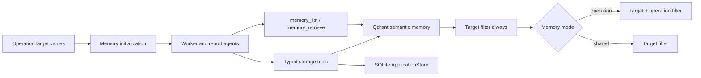

# Memory System

Cyber-AutoAgent uses two complementary persistence layers:

- Qdrant stores semantic memories such as observations, verified findings, validation records, and reusable knowledge.
- SQLite stores authoritative workflow state such as operation plans, phases, tasks, acceptance outcomes, finding
  validation, and timestamped per-model assessment metrics.

Qdrant is the only semantic-memory backend. By default it runs as an embedded filesystem database under
`./outputs/qdrant`. A Qdrant service can be configured without changing the memory model or agent tools.

## Architecture



All operations use the same physical Qdrant database and the same `outputs/cyber_autoagent.db` application database.
Query scope comes from record identity rather than separate databases.

## Identity and isolation

Every semantic-memory point contains:

- `target_values`: exact values from the operation's `OperationTarget` records.
- `operation_id`: the operation that created the point.
- `memory`: searchable content.
- `metadata`: category, status, evidence references, and other typed-memory fields.

Target filtering is mandatory for every list, search, get, and delete operation. Sanitized output-directory names are
never used as target identity.

SQLite workflow rows are keyed by the exact logical `--target` string and operation ID. This composite identity keeps
targets distinct even when their strings produce the same sanitized output-directory name. Database-wide tables can
omit that operation scope when future application features require global state.

The `--memory-mode` option controls only query scope:

| Mode | Qdrant criteria | Intended use |
| --- | --- | --- |
| `operation` | Target value and operation ID | Isolate retrieval to the current run. This is the default. |
| `shared` | Target value | Reuse knowledge from other operations against the same target. |

Writes always retain both target values and operation ID, including in shared mode. This preserves provenance and lets
operation reports select their own authoritative records.

Examples:

```bash
# Isolated retrieval for a new operation
uv run python src/cyberautoagent.py --target https://example.com --memory-mode operation

# Reuse memories from earlier operations against exactly the same target value
uv run python src/cyberautoagent.py --target https://example.com --memory-mode shared
```

The former `auto` and `fresh` values are no longer CLI values. Persisted React configuration is normalized once:
`auto` becomes `shared`, and `fresh` becomes `operation`.

## Storage options

### Investigating frozen inventory records

`get_inventory_item` reads current-operation inventory manifests without changing their frozen contents.
Its default `view="record"` preserves the full-record lookup. Use `view="investigation"` with an exact
`item_id` to retrieve explicitly linked records, operation provenance, client request declarations,
structural diagnostics, and source excerpts:

```python
get_inventory_item(
    manifest_ref="artifact:artifacts/inventory.json",
    item_id="endpoint-example",
    view="investigation",
    context_offset=0,
    context_limit=20,
)
```

Follow `next_context_offset` until it is null; `context_limit` accepts 1–50 entries. Pages also respect
the tool's output ceiling. An entry that cannot fit produces an explicit error rather than silently
losing fields; inspect that record with `read_artifact`. Ambiguous selectors return candidate IDs rather
than expanding several subjects. The aliases `raw` and `context` normalize to `record` and `investigation`
inside the tool; the advertised schema uses canonical values.

An investigation joins only explicit same-target relationships. HTTP client declarations are interpreted
by a dedicated adapter. Their URLs are compared by origin and path, with query and fragment removed;
different paths remain distinct. An `operation_endpoint_mismatch` preserves both the assigned endpoint
and the conflicting declaration. Existing frozen manifests are never repaired in place. New inventory
consolidation keeps parameter names separate by parent endpoint and input location.

Excerpts use recorded source locations, span at most 200 lines and 8,000 characters per operation, and split long lines into
bounded pieces. An `excerpt_limit` diagnostic identifies any remaining range for a targeted artifact read.
Source digests are verified when recorded by the client extractor; legacy excerpts explicitly report
`digest_verification="unrecorded"`. Sources outside the current operation or the evaluator's allowlist
are unavailable. Source files over 16 MB require a separate targeted artifact inspection.

Client route context also follows source-backed JSX and compiled React route declarations into uniquely
resolved local components and request helpers. Conditional branches and callbacks retain their source
locations. Traversal stops after four local call edges or 32 definitions per route; unresolved bindings,
imports, cycles, and limits remain explicit. API requests reachable from a client route are separate from
operations implemented by that route. No JavaScript is executed and no server authorization conclusion
is inferred. Existing saved bundles are indexed lazily under `artifacts/client_route_indexes`, keyed by
source digest and extractor version, so this context does not require rerunning mapping or changing a
frozen inventory. Identical source copies share analysis rather than repeating their excerpts.

These records describe evidence availability and provenance, not security conclusions. Empty inputs mean
unrecorded inputs; inferred methods are not exhaustive; frontend requests do not prove server handling.
Hypothesis workers use this context before searching raw artifacts. A necessary missing input goes through
structured prerequisite review, not `no_testable_hypotheses`. When review requires both inspection and
publication revision, inspection runs first within the existing bounds, followed by publication and review
of the new digest. The 16-call discovery checkpoint is unchanged.

### Preserving inspected evidence across hypothesis turns

Successful inspection tools save their exact returned text beneath `artifacts/hypothesis_context/returned_results`.
Each result binds the operation, task, frozen snapshot, tool-call ID, arguments, source references, and content
digest. The controller captures results immediately, before shortened outcome summaries replace them.
These are sensitive internal artifacts, subject to the same handling as other non-report evidence.

Fresh hypothesis workers, checkpoint publication, repairs, and evaluators receive up to 4,000 tokens of
complete recent results, with duplicate content grouped and omissions disclosed. Prompt fitting can omit
replay bodies while retaining the saved-result index and the required publication instructions. Older ledgers
that recorded only arguments explicitly identify their missing content; they are never treated as observations.

`read_inspection_result(inspection_ref, offset=0, max_chars=4000)` pages a saved result or its index. The
maximum page size is 10,000 characters, additionally bounded by the tool-output ceiling. Follow `next_offset`
for further pages. The tool permits four reads per instance and cannot reopen original evidence, read another
task or snapshot, or restart discovery. Checkpoint publication has an eight-model-turn ceiling to accommodate
the saved-result reads and publication calls. Ordinary discovery still checkpoints at 16 calls.

For newly evaluated empty hypothesis publications, subject review includes `no_hypothesis_basis`:

| Basis kind | Required behavior |
| --- | --- |
| `inspected_evidence` | Cite retained `inspection_refs` containing inspected content; the evaluator must judge its semantic adequacy. |
| `metadata_only` | Repair the publication; unrecorded inputs and inferred operations cannot establish completed empty coverage. |
| `necessary_evidence_unreviewed` | Identify concrete frozen-source `prerequisite_gaps` and use focused inspection recovery. |

A valid inspection reference establishes provenance and content availability only. It does not independently
prove support, contradiction, or the absence of a vulnerability. Existing terminal publications remain unchanged;
the stronger review contract applies when a task is newly evaluated or explicitly rerun.

### Embedded filesystem storage

No service configuration is required. The default layout is:

```text
outputs/
├── qdrant/                         # Semantic memories for every operation
├── cyber_autoagent.db              # Workflow state for every target and operation
└── <sanitized-target>/
    └── <operation-id>/              # Reports, logs, artifacts, and tools
```

SQLite schema changes are forward-only SQL files in `src/modules/storage/migrations`, ordered by their four-digit
prefix. Startup applies each migration transactionally and records its filename and checksum in `schema_migrations`.
An applied migration must never be edited; add the next numbered file instead.

Before writable workflow state is initialized, the application runs SQLite `PRAGMA integrity_check`. If the existing
database is unreadable or fails that check, it preserves timestamped `cyber_autoagent.corrupt-*.db` forensic copies
and any SQLite `-wal`, `-shm`, or `-journal` sidecars. It then attempts SQLite's native `.recover` command and
validates the recovered database before installing it. If recovery fails, the application starts with a fresh migrated
database; the preserved files remain available for operator-led forensic recovery.

At assessment finalization, SQLite appends one metrics row per provider/model. Continued operations retain earlier
captures; reports render every capture in timestamp order rather than combining them. Report-only runs read this
history without adding metric rows.

The embedded Qdrant client is suitable for a single Cyber-AutoAgent process. Use a Qdrant service when multiple
processes or hosts need concurrent semantic-memory access.

### Qdrant service

Set `QDRANT_URL` to use a service. Set `QDRANT_API_KEY` when the service requires authentication.

```bash
export QDRANT_URL=http://localhost:6333
export QDRANT_API_KEY=optional-secret
uv run python src/cyberautoagent.py --target https://example.com
```

The Docker Compose file includes an optional Qdrant service profile:

```bash
QDRANT_URL=http://qdrant:6333 docker compose --profile qdrant up
```

Its data is persisted in the repository `outputs/qdrant` directory.

## Agent tools

Agents use provider-neutral names:

- `memory_list`: returns a bounded list in the configured target/operation scope.
- `memory_retrieve`: performs semantic retrieval in that same scope and accepts metadata filters.
- Typed storage tools such as `store_observation`, `store_finding`, and `record_finding_validation` enforce their own
  schemas and write semantic or workflow records as appropriate.

Workflow bookkeeping tools are intentionally separate from semantic retrieval. Qdrant does not replace SQLite as the
authoritative source for task, phase, acceptance, or validation status.

`store_finding` validates typed positive assertions in durable artifacts, records internal candidate-persistence
receipts, and fingerprints cited evidence. Existing `marker` assertions remain valid and normalize to `literal_text`.
New assertions may use exact text, an encoded byte sequence, or a JSON Pointer with a narrow data-only operator;
arbitrary executable predicates are not accepted. When a source task's frozen criterion is solely candidate
persistence, the controller records that task acceptance from the returned finding reference; this does not verify the
security claim.
The separate verification task receives the candidate's structured reproduction packet and records the finding outcome
from fresh evidence.

Workflow prompts exclude automatically published task-acceptance memories and any semantic plan/task bookkeeping.
Those records remain available for audit and reporting, while agents receive the controller-owned task history and
acceptance ledger instead. Ordinary observations, findings, validation outcomes, and reusable knowledge remain eligible
as supporting prompt context in either memory mode.

Reports apply the same distinction to informational observations: task-acceptance and plan/task bookkeeping records
remain in canonical evidence for auditability, but are omitted from the informational-observations narrative and its
LLM context because the deterministic task and acceptance tables already represent them.

## Embeddings

Qdrant stores vectors generated by the configured operation embedding provider. The collection has one configured
dimension, so changing to a model with a different vector size requires a new collection name or an explicit migration.
The application validates vector dimensions before writing.

No automatic import of legacy semantic-memory files is performed. Keep old output directories as archives or migrate
them with a purpose-built, reviewed process.

## Configuration

| Variable | Default | Description |
| --- | --- | --- |
| `CYBER_MEMORY_MODE` | `operation` | Query scope: `operation` or `shared`. |
| `QDRANT_URL` | unset | Qdrant service URL. Unset selects filesystem storage. |
| `QDRANT_API_KEY` | unset | Optional Qdrant service API key. |
| `QDRANT_COLLECTION` | `cyber_autoagent_memories` | Semantic-memory collection name. |
| `CYBER_AGENT_OUTPUT_DIR` | `./outputs` | Parent of the local `qdrant` directory and operation outputs. |
| `CYBER_AGENT_EMBEDDING_MODEL` | provider default | Embedding model used for Qdrant vectors. |
| `MEMORY_LIST_LIMIT` | `100` | Maximum default records returned by bounded list operations. |

These variables are represented in `.env.example`; Docker Compose forwards the service-related values.

## Cleanup and reporting

When memory retention is disabled, cleanup deletes points matching the operation ID and leaves the shared database and
other operations untouched. Raw artifacts are not modified.

Reports use the current operation's SQLite records and operation-tagged semantic evidence. Shared mode helps agent
reasoning across earlier runs but does not allow another operation to overwrite current operation status, counts, or
validation outcomes.

## Troubleshooting

- **Qdrant cannot open the local path:** verify `CYBER_AGENT_OUTPUT_DIR` is writable and only one process owns the
  embedded database. Use a service for concurrent processes.
- **Dimension mismatch:** choose an embedding model matching the collection dimension or configure a new collection.
- **No shared results:** target values must match exactly. A URL and hostname are distinct unless both are explicit
  `OperationTarget` values.
- **Service connection failure:** check `QDRANT_URL`, credentials, network access, and the service health endpoint.


### Reviewing empty hypothesis outcomes

Investigation pages prioritize subject declarations and source excerpts before broad references and
metadata diagnostics. The additive `remaining_context` map identifies the first remaining offset for
each context type; continue with `context_offset` when relevant evidence is outside the first page.

Checkpoint replay balances returned content across sources and retains small verbatim evidence anchors
when optional replay bodies are removed during prompt fitting. Large results include serialized-result
slice offsets for recovery through `read_inspection_result`; complete results remain in the scoped journal.
These excerpts establish what was inspected, not whether a security conclusion is supported.

New empty-result reviews must provide evidence-linked `behavior_assessments` (observed behavior,
inspection references, whether it supports a conditional test, and reasoning), or
`no_relevant_behavior_reason` when inspected content contains no relevant behavior. An assessment
supporting a conditional test requires publication repair. Historical reviews remain readable.
Missing server observations and unrecorded inputs do not independently prohibit proposing future tests.
