# Security techniques

Techniques are global, reusable Markdown guidance for reconnaissance, hypothesis generation,
verification, source analysis, and execution. They do not belong to a target or operation and cannot
satisfy execution receipts, finding validation, or current-operation evidence requirements.

An agent calls `get_technique(request)` with a generic natural-language description. A structured planner
splits broad requests into a flat list of independently reusable components and explicit requirements;
a separate review checks that mechanisms and deliverables were preserved without invented requirements.
Narrow requests remain one component. Each component resolves independently. The operation-local Markdown
bundle includes complete validated techniques, per-component applicability, and actionable unresolved gaps.
Equivalent components are deduplicated, and repeated revisions appear in full once. Partial bundles are
returned when any component succeeds; total failure returns diagnostics. Only individual validated
techniques enter the global catalog. Direct callers retain `get()` and its `(revision, markdown)` tuple;
operation tools and CLI use the typed `resolve_bundle()` API.

Existing active guidance is judged for applicability before reuse. A miss invokes separate researcher, source judge,
author, and critic agents. Research starts with a target of three relevant fetched documents, with no
three-source selection cap. Sufficiency depends on requirement support, authority, contradictions and
version relevance; one authoritative document may suffice, and three documents may remain inadequate.
Each component has at most three research batches, each with three searches and six fetch attempts.
Later batches target explicit coverage gaps and reject refetches of known documents. Sources are assessed
separately with bounded coverage summaries rather than concatenating all fetched text. Coverage records
contain requirement IDs, supporting URLs, explanations and unresolved gaps. Python validates references;
the judge assesses meaning. Source snippets are discovery leads, not documents. Inputs exceeding the
configured prompt limit fail explicitly, preserving exact-document critique instead of truncating it.
Up to three author attempts are allowed, with independent critique before publication. Critique distinguishes
authored-content, request-coverage, source-attribution and research-coverage defects. Procedure or omitted
request content returns to the author; attribution returns to selection once per selection round; missing
support returns to targeted research within the component's three-batch limit. Attribution and research
repairs retain the authored draft. Exhaustion yields an explicit unresolved result. Python owns fetched
URLs, titles, timestamps and individual attribution, separately from overall coverage. Similar attribution
wording alone is not rejection grounds. Source code informs reasoning; original examples use Python 3.13+ or browser JavaScript.

During operations, Python binds lookup to structured phase metadata, task purpose, subject descriptors,
available capabilities, task constraints and bounded observations. Source files, symbols, hosts, services, configurations,
traces and module-defined subjects are supported; no HTTP traffic, inventory or live execution is required.
The lookup judge abstracts incidental target identifiers before external research and global authoring,
while preserving relevant platform, language, protocol, version and standard-path constraints.
Task applicability is assessed without catalog candidates. Candidate selection is separate: no matching
guidance triggers research and generation, not task rejection. Incompatibility requires a conflicting
requirement and an exact reference to a supplied constraint or subject-specific source observation.
Before rejecting an incompatibility, an independent confirmation checks whether advisory guidance or
future validation was confused with final task requirements or present execution. Disagreement returns
assessment uncertainty, without claiming applicability or a task conflict.
Malformed assessments receive one repair attempt; continued failure is reported as an assessment error.
Existing guidance is filtered by declared phase compatibility when phase context is known, independent
of its originating module. Legacy phases without contexts remain explicitly unknown and use task purpose.

Operation responses append a local applicability assessment: supported or conditional. Conditional
guidance names unmet prerequisites and asks the worker to establish them within scope; hypothesis phases
describe future checks only. Contradicted prerequisites or permission conflicts reject the lookup. These
notes are excluded from global documents and produced snapshots. CLI lookups include them when
`--phase` or `--constraint` supplies task context. Source-selection
metadata is assembled before critique, so the critic reviews exactly the document that will be published.

```mermaid
flowchart LR
    O[Observed evidence + phase metadata] --> T[Detectors and semantic trigger matcher]
    T --> R[Lookup recommendation]
    R --> A[Worker chooses get_technique]
    A --> P[Flat component plan + requirement review]
    P --> Q[Per-component global active technique search]
    Q --> J[Applicability judge]
    J -->|miss| W[Researcher + source judge]
    W --> G{Requirement coverage sufficient?}
    G -->|gaps; batches remain| W
    G -->|yes| C[Author + critic]
    G -->|exhausted| X[Unresolved component]
    C --> S[Store approved Markdown]
    J -->|match| U[Return guidance]
    S --> U
    U --> B[Operation-local bundle with unresolved components]
    X --> B
    B --> E[Independent per-revision use evaluator]
    E --> F[Sentiment and active status]
```



## CLI

The CLI prints the bundle and exits successfully for partial delivery, with an incompleteness notice.
It exits unsuccessfully when no component resolves and creates no operation-use receipts.

```bash
uv run caa-technique \
  "JWT trust-boundary analysis" --module web --provider ollama \
  --phase hypothesis_generation --constraint "No live execution"

uv run caa-technique \
  "Validate the prerequisites and applicability of CVE-YYYY-NNNN" \
  --provider litellm --model your-configured-model --output-dir ./outputs
```

`--phase` is optional and repeatable. Accepted values are `reconnaissance`, `hypothesis_generation`,
`vulnerability_verification`, `execution`, and `analysis`. Explicit phases filter reusable candidates
and require generated guidance to support at least one requested phase. `--module` selects module
imports independently of phase.

Use repeatable `--constraint` options for restrictions such as `"Read only"` or `"No live execution"`.
Constraints inform the phase-aware applicability assessment; future validation guidance does not
authorize present execution. Blank constraints and unknown phases are rejected before storage opens.
With constraints but no phase, the phase remains explicitly unknown. With neither option, generic
lookup retains its existing behavior without task-applicability notes. The request supplies task purpose;
no target or operation identifier is required. Applicability notes remain local to CLI output and are
excluded from published techniques.

Replace the placeholder CVE and model with real values. The command imports the selected module and
its inherited modules, then uses exactly the same lookup and generation service as operation agents.
It requires no assessment target and creates no assessment or use rating. Successful stdout contains
only the complete Markdown document; diagnostics go to stderr. Failures return exit status 1. A
concurrent identical build returns a retryable busy error. Embedded Qdrant permits one owning process;
use a Qdrant service for simultaneous CLI and operation access to the same store.

### CLI progress and diagnostic logs

Normal runs show concise progress on stderr: initialization, module synchronization, planning,
research rounds and source counts, author/critic attempts, repairs, and reuse or generation.
`--verbose` adds role/model/tool timing and correlation identifiers; `--quiet` shows only warnings
and errors. These options are mutually exclusive. Stdout remains exclusively the Markdown bundle.

Each invocation automatically creates a new private JSONL log under
`<output-dir>/techniques/logs/<UTC-timestamp>_<UUID>.jsonl`. The path is announced on stderr unless
quiet. Use `--log-file PATH` to choose another path; existing files are never overwritten.
New log directories use mode `0700`, and files use `0600`. Help and argument errors create no log.

```bash
uv run caa-technique "Source-to-sink review" --module code_security --verbose > guidance.md
uv run caa-technique "Network trust boundaries" --quiet --log-file ./diagnostics/network.jsonl
# Read stage transitions and final outcomes from a saved run:
jq 'select(.type == "technique_build_progress" or .type == "bundle_completed")' path/to/run.jsonl
# Inspect each fitted model input and observed model response:
jq 'select(.type == "model_input" or .type == "model_output")' path/to/run.jsonl
```

All verbosity modes save detailed records, including system instructions, fitted conversation messages,
tool schemas, model responses, research-tool inputs/results, available usage counts, timings, and
sanitized exceptions with stack traces. Records carry run, component, activity, role-invocation,
model-attempt, and tool-call identifiers where available. Each attempted response is recorded; final
role completion or failure is separate. Prompt inputs are recorded after budget fitting, before any
provider-specific wire transformation. Missing usage data is not fabricated.

Conversations are file-only. Secret-bearing fields, recognized credential text, registered runtime
secrets, and known private values are redacted before writing or display; logging does not change
agent inputs or published guidance. Binary content is omitted. Logs retain complete textual records
after redaction, can become large, and remain local until manually removed. Redaction is conservative
and cannot identify every arbitrary unlabeled secret. These diagnostics are separate from operation
evidence and technique-use ratings; provider wire-level debug logging is not enabled.

If automatic log creation fails, the CLI warns and continues with stderr progress. An invalid explicit
`--log-file` fails before service initialization. A write failure warns once and disables file logging
without aborting lookup. Configuration errors before an output directory can be resolved are reported
on stderr. Partial bundles retain successful exit status and emit a warning with delivered/unresolved
counts. Other lookup failures retain exit status 1. Logs flush as records are written and close on exit.

## Module documents

For interactive authoring, use the repository [create-technique skill](../.agents/skills/create-technique/SKILL.md),
for example: `Use $create-technique to develop JWT verification guidance for the web module.`
It collaborates on the brief, sources, procedure, and final draft; separate agents select sources and
critique the document. It validates the current document contract and saves only after final review.
Authoring does not import into Qdrant or run an assessment.

Save documents under `<module>/techniques/**/*.md`. Startup imports the selected module's inheritance
chain. Imported active techniques are searchable globally, regardless of the importing operation's
memory mode. Each module includes `docs/technique-generation-prompt.md`, an example prompt for use in
an external assistant.

```yaml
---
schema_version: 1
title: JWT trust-boundary hypothesis generation
purpose: Turn observed JWT handling into grounded future verification plans.
applicability:
  - An assigned interaction contains a compact signed or encrypted token.
phases: [hypothesis_generation]
active: true
triggers:
  - phases: [hypothesis_generation]
    when: A JWT appears anywhere in a captured request or response.
    signals_any: [http.jwt]
    request: JWT trust-boundary hypothesis generation
sources:
  - url: https://www.rfc-editor.org/rfc/rfc8725.html
    title: RFC 8725 JWT Best Current Practices
    retrieved_at: '2026-10-25'
    selection_reason: Primary guidance on validation and trust boundaries.
source_coverage: Primary guidance; implementation-specific controls still require inspection.
---
```

The web module separates `jwt-hypotheses.md` (candidate design from recorded evidence) from
`jwt-verification.md` (controlled live comparisons and finding evidence). Each advertises only its
own phase and includes RFC and PortSwigger sources; token observation recommends lookup without
establishing a vulnerability.

Follow the frontmatter with complete prerequisites, procedure, positive and negative controls,
interpretation, failure cases, and limitations. The document limit is 48,000 characters. Named tools
may have preferred options, but the procedure must remain usable with equivalent available tools.
Do not include real targets, operation identifiers, credentials, or observed secrets in global guidance.
Runtime metadata adds revision identity, origin, active status, source digest, and sentiment summary.

Identity uses the module name, module-relative path, and SHA-256 of the original UTF-8 document bytes.
Unchanged documents are not reimported, including negatively evaluated revisions. An updated document
supersedes the previous logical revision while retaining history. Removed files do not purge global
records. Generated replacements retain the matched inactive technique's lineage when appropriate.

## Trigger recommendations

Phases advertise `technique_contexts` in structured planning metadata. Recommended identifiers are
`reconnaissance`, `hypothesis_generation`, `vulnerability_verification`, `execution`, and `analysis`.
The existing `produces_hypotheses` flag and finding-validation task kind supply compatible contexts for
older plans; phase names and numbers never imply a context. Module phase contracts may fix contexts.

Techniques advertise natural-language trigger conditions and generic lookup requests. Trusted modules
may also provide `technique_signals.py` with `detect(text)` and `sanitize(text)` functions. The web
adapter recognizes structurally valid compact JWT/JWE candidates, including ordinary URL encoding,
wherever they occur in captured text. It does not verify signatures or infer vulnerability.

The controller scans assigned inventory records, referenced captures, and task tool results. Matching
recommendations include source references and digests, never actual token values. A separate semantic
matcher considers up to 20 phase-compatible candidates and a 12,000-character observed excerpt, with
six semantic passes per task. Deterministic detection continues after that allowance. Source captures
over 16 MB, unavailable captures, and exhausted semantic allowances remain explicit limitations.
Only captured content can be inspected; missing browser/network bodies are not assumed observed.

Recommendations persist through continuation and are advisory: the worker decides whether to request
the technique. Inactive current revisions retain their trigger advertisements so a later request can
rebuild their guidance. Superseded advertisements do not produce recommendations. Neither a trigger
nor the resulting technique establishes a security conclusion.

## Lifecycle and debug output

Python records a successful delivery once per operation, task, and revision. The executor never rates
itself. A separate evaluator scores the use as helpful `+1`, neutral/unused/indeterminate `0`, or
unhelpful `-1`, with a reason. Correctly excluding a vulnerability may be helpful. Task failure or an
unavailable tool does not independently justify a negative score. Failed evaluations remain pending
for continuation instead of receiving invented ratings.

A revision deactivates after at least three scored uses when its cumulative mean is at most `-0.5`.
It is then excluded from guidance retrieval. Generation considers matching inactive documents and
their feedback as cautionary context, distinguishing poor feedback from supersession. CLI retrievals
and recommendations alone do not count as uses.

During an operation, debug copies are written outside the evidence artifacts directory:

```text
outputs/<target>/<operation>/
├── artifacts/                       # Operation evidence
└── techniques/
    ├── <revision>.produced.md         # Written immediately after approved publication
    └── <revision>.evaluated-<use>.md   # Written after use evaluation, including score and reason
```

Existing techniques receive an evaluated-use copy after their sentiment is determined. Each task gets
a separate copy; later uses do not overwrite earlier snapshots. Copies include complete guidance and
metadata, and evaluated copies include that use's score, reason, task, and operation. Failed evaluated
exports are retried from scored use records on continuation. These files are debug guidance, never
assessment evidence. The standalone CLI writes no operation debug copies.

Qdrant stores source Markdown, rendered documents, and model-specific semantic indexes. SQLite stores
global lifecycle, feedback, use receipts, and recoverable build leases. Pending synchronization is
reconciled before retrieval, and lifecycle is checked again before returning guidance. Embedding
configuration changes rebuild the semantic index from the stored documents. Operation `store_knowledge`
remains scoped to its existing target and operation; it is not the global technique store.

| Existing setting | Purpose |
| --- | --- |
| `QDRANT_URL` | Optional Qdrant service; embedded output-root storage is the default. |
| `QDRANT_API_KEY` | Optional authentication for the configured Qdrant service. |
| `CYBER_AGENT_OUTPUT_DIR` | Output root for embedded Qdrant and the application database. |
| `CYBER_AGENT_PROVIDER` | Configured model and embedding provider. |
| `CYBER_AGENT_LLM_MODEL` | Configured default model for technique roles. |
| `CYBER_AGENT_EMBEDDING_MODEL` | Embedding model used by technique similarity indexes. |

No additional environment variables are required. Research HTTP fetches honor the existing proxy
environment settings. Search and fetch allowances, document bounds, and feedback thresholds are code
defaults, rather than operation budgets or limits on planned task counts.

### Research trust and trigger efficiency

Source fetching uses Python's system TLS trust configuration, including proxy CAs installed at startup
and existing `SSL_CERT_FILE` / `SSL_CERT_DIR` overrides. Environment proxies and `NO_PROXY` still apply.
Certificate verification remains enabled. A certificate-verification failure stops further searches and
fetches for that research attempt and returns a trust-configuration diagnostic through tool events.

Semantic trigger decisions are cached within the operation for the same phase contexts, trigger
fingerprint and sanitized excerpt. Each trigger has its own cached decision; adding guidance preserves
decisions for unchanged triggers and never resets a task's six-call allowance. The cache stores only selected trigger IDs, never source
excerpts or model reasons. Both positive and negative valid decisions can be reused across tasks and
continuations; each task retains its own recommendation provenance. Failed decisions remain retryable.
Only actual model calls consume the six-call per-task allowance. Seeded evidence and non-empty tool
outputs receive semantic matching; tool inputs receive deterministic detection only. Deterministic
signals continue to be checked after the semantic allowance is exhausted.

Assigned subject observations precede shared artifact excerpts. Recommendations retain source/unknown
origin and subject/shared scope. Trusted tool declarations use `_cyber_technique_observation_origin`
with `source`, `analysis`, `guidance` or `unknown`; undeclared and runtime-added tools default to unknown.
Generated analysis and guidance, including published hypotheses, cannot trigger their own prerequisites.
Their artifact origins persist within the operation so later reads and continuations keep that distinction.
Unknown observations may suggest conditional investigation but cannot establish applicability. Modules
without signal adapters still use semantic recommendations and lookup without web imports.

Use receipts retain the first delivery's `use_context` with generic intent, phase contexts, applicability,
unmet prerequisites and source references/digests. Repeated deliveries do not overwrite that context or
count as new uses. Legacy `{}` context remains unknown. Evaluation rates demonstrated contribution to
the requested purpose, not coverage of every task requirement: excluding a source-to-sink path, resolving
a system dependency or improving emulation telemetry may be helpful without live vulnerability testing.
Applicability mismatch is distinct from document quality; negative feedback requires demonstrated harm
or misleading guidance. Existing ratings and revisions are not rewritten automatically.

Agents prefer techniques for reusable methodology and direct web research for target-specific public
intelligence. Both tools remain available, and lookup remains the executor's decision.

Regeneration must revise an identical inactive generated document; it cannot reset that revision’s
feedback or return inactive guidance. The existing author/critic revision limit still applies.

## Lifecycle visibility

Calls to the same bound `get_technique` tool run one at a time, including under concurrent executors.
The guard covers bundle resolution and rendering and releases on failure. Other tools and separate
task bindings can still run concurrently. Multiple calls in one model turn remain valid; serialization
does not remove duplicate calls or guarantee a particular scheduling order.

The TUI and headless console show technique library synchronization counts, new task
recommendations, reuse or generation, and research, source selection, authoring, and critique
milestones. Source selection includes fetched and selected document counts. Revision messages
include the attempt number. Individual source fetches and model turns are not additional events.

Independent evaluation displays helpful (+1), neutral (0), or unhelpful (-1), its sanitized
reason, and any feedback-driven deactivation. Successful generation and evaluation messages
include snapshot paths under the operation's `techniques/` directory. Export warnings indicate
that the document was stored but a snapshot is unavailable. A later lookup retries a missing
produced snapshot; continuation retries evaluated snapshots without rescoring the same use.

Messages include task identifiers where applicable. Recommendation replay and repeated feedback
do not announce new transitions. Generic tool events still own lookup start, completion, and
propagated errors. Recoverable recommendation, evaluation, and export issues use technique warnings.
Documents, drafts, source bodies, and observed target content are excluded from lifecycle events.
The standalone `caa-technique` command retains Markdown-only stdout.


### Generated document validation and diagnostics

The author generates JSON containing technique metadata and a Markdown body. Python validates the
response and renders YAML frontmatter; the independent critic reviews the resulting document.
Generation allows three author attempts, with repair feedback identifying JSON, schema, document
validation, or critique failures. Exhaustion reports the final failure stage.

During operations, rejected responses are saved immediately as private diagnostic JSON files under
`techniques/builds/<activity-id>/attempt-<number>.json`, outside `artifacts/`. Each file includes
the response, failure stage, attempt, and feedback. Responses are capped at 128,000 characters with
an explicit truncation flag. These sensitive internal diagnostics are not evidence or published
guidance. The TUI and console show sanitized reasons and relative diagnostic paths, never draft
contents. A diagnostic write failure does not interrupt generation. Produced and evaluated Markdown
snapshots retain their existing locations. The CLI still prints only the resolved Markdown to stdout
and reports failures on stderr.

### Bundle correlation and contribution review

Lifecycle events include `component_id`; research and selection events include `research_round`.
Each delivered revision gets one idempotent receipt per task. Delivery-context JSON includes component
purpose and requirements, with a `components` list when multiple components reuse a revision. Unresolved
components create no receipts. The evaluator identifies observed contribution, non-use or misleading
effect for each revision. Genericity, conditional prerequisites, incomplete execution and task failure
alone do not justify zero. Unestablished contribution remains neutral; legacy delivery context is unknown.
Historical ratings and documents are unchanged; no SQL migration is needed.

Offline tests verify controller routing and contracts. A subsequent live continuation must confirm
relevance, repair effectiveness, semantic source coverage and contribution judgments.

The CLI selects its generation model from `--model`, then `CYBER_AGENT_LLM_MODEL`,
then the provider default. Startup diagnostics report that effective model. Output, SDK,
and embedding configuration reads do not probe unrelated generation models. Embeddings
retain their independent configuration; `--model` does not replace the embedding model.
